# W3 第 1 节课：从 Unity 场景到 WebAR

对应 deck：`W3Slides/Unity-Needle-WebAR-basic.md`。

这一部分不写脚本。`prerequisite/` 里只用到一个文件：`Install Needle Engine Unity Integration.unitypackage`。

做完后你会得到一个名为 `FirstWebAR` 的场景，里面有一个 `Cube`。它可以在电脑浏览器里预览，也可以在支持的手机上进入 AR。后面两节课都在这个场景上继续做，请保存好。

## 课前准备

课前只需要完成备课笔记第 1 节“课前准备与预习要求”里的内容，链接都在备课笔记里：

1. 安装国际版 Unity Hub 和 Unity 6.3 LTS。
2. 安装 Node.js 和 VS Code。
3. 看 Needle Engine Getting Started 指南，了解插件的安装方法。
4. 完成 Unity 基础的三个自学教程，看 Needle Engine 的快速上手文档和视频。

其余的检查和设置都在课上一起做，见下面的第 0 步。

## 第 0 步：上课开始时检查环境

这一步在课上一起做。有一项不满足，告诉老师。

### 检查 Unity

1. 打开 Unity Hub，确认已经用 Unity ID 登录。
2. 在左侧点 `Installs`，列表里应有一个版本号以 `6000.3` 开头的条目，这就是 Unity 6.3 LTS。

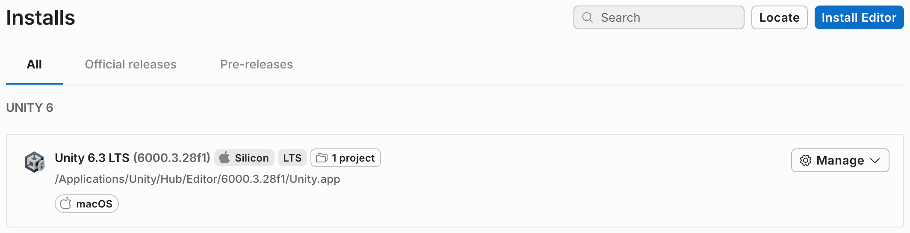

3. 左上角齿轮图标的 `Licenses` 里应有一个 Personal 许可证。没有的话点 `Add`，选择 `Get a free personal license`。

### Windows 用 Git Bash 运行命令

本教程所有终端命令，Windows 在 Git Bash 里运行，macOS 在“终端”里运行。两边的命令相同。Windows 上不要用 PowerShell 或 cmd（命令提示符）。

Workshop2 用的是 PowerShell。换成 Git Bash 后，`cd`、`git clone` 和按 `Ctrl+C` 停止程序的用法不变。

Git Bash 不用另外安装。Workshop2 安装 Git for Windows 时选项全部保持默认，Git Bash 已经在电脑上。

打开 Git Bash 有两种方法：

1. 按 Win 键，输入 `Git Bash`，点击搜索结果。窗口打开后停在用户目录。
2. 在文件资源管理器里打开要运行命令的文件夹，在空白处点右键，选 `Open Git Bash here`。Windows 11 的右键菜单里看不到这一项时，先点“显示更多选项”。窗口打开后直接停在这个文件夹，不用再输入路径。

应该看到：窗口标题栏有 `MINGW64` 字样。提示符的第一行是用户名、电脑名和当前目录，第二行是一个 `$`，命令输在 `$` 后面。提示符以 `PS C:\` 开头的是 PowerShell，以 `C:\` 开头的是 cmd，这两种窗口都关掉，改开 Git Bash。

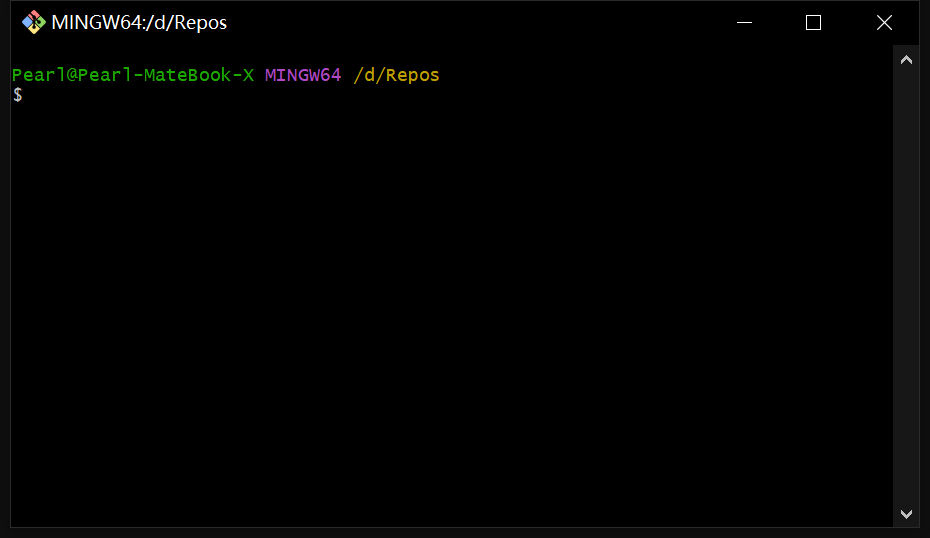


把 VS Code 的内置终端默认设为 Git Bash，只需要做一次：

1. 打开 VS Code，按 `Ctrl+Shift+P` 打开命令面板。
2. 输入 `Terminal: Select Default Profile`，回车。
3. 在列表里选 `Git Bash`。
4. 点菜单 `Terminal > New Terminal`。新终端面板的右上角显示 `bash`，说明设置生效。
5. 设置之前就开着的终端不会改变。名称是 `powershell` 或 `cmd` 的，点面板右上角的垃圾桶图标关掉。


Git Bash 和 PowerShell 的写法有几处不同：

| 事项 | Git Bash 里的写法 |
| --- | --- |
| 用户目录 | 写成 `~`。`cd ~` 回到 `C:\Users\你的用户名`，相当于 Workshop2 里的 `cd $HOME` |
| 盘符和分隔符 | C 盘写成 `/c/`，分隔符用 `/`。`C:\Users\你的用户名\W3WebAR` 写成 `/c/Users/你的用户名/W3WebAR` |
| 路径里有空格 | 给整个路径加双引号，例如 `cd "/c/Users/你的用户名/My Projects"` |
| 从文件资源管理器地址栏复制的路径 | 这种路径带反斜杠 `\`，粘贴时用单引号包起来，例如 `cd 'C:\Users\你的用户名\W3WebAR'` |
| 复制 | 用鼠标选中文字，点右键选 `Copy`，或按 `Ctrl+Insert`。`Ctrl+C` 在这里不是复制 |
| 粘贴 | 点右键选 `Paste`，或按 `Shift+Insert`。`Ctrl+V` 在这里不能粘贴 |
| 停止正在运行的程序 | 按 `Ctrl+C`，和 Workshop2 相同 |
| 查看当前位置 | `pwd` 显示当前目录，`ls` 列出当前目录里的文件 |

VS Code 的内置终端里，复制和粘贴可以直接用 `Ctrl+C`（先选中文字）和 `Ctrl+V`。

Git Bash 只在窗口打开时读取一次系统的 PATH（系统查找程序的目录列表）。装完 Node.js 之后，把已经开着的 Git Bash 窗口全部关掉再重新打开，才能识别 `node` 和 `npm`。VS Code 的内置终端也一样，要完全退出 VS Code 再打开。Workshop2 里装完软件后要重开 PowerShell，是同一个原因。

点 Unity 的 Play 时，Needle 会自己启动本地服务器，可能弹出一个单独的命令行窗口。这个窗口由 Needle 管理，不属于上面的约定，不要在里面输入命令。

### 检查 Node.js 和 VS Code

全班统一用 Node.js 24 LTS。Needle 目前不支持更高的版本。课前按备课笔记装的是当时的 LTS 版本，这里确认一下版本号。

1. 打开终端。Windows 打开一个新的 Git Bash 窗口，macOS 打开“终端”。
2. 输入下面两条命令，每条输完按回车：

```bash
node -v
npm -v
```

应该看到：`node -v` 输出以 `v24` 开头的版本号，`npm -v` 输出一个由数字和点组成的版本号。

`node -v` 输出的版本号不以 `v24` 开头，说明电脑上装的是别的版本。先卸载现有的 Node.js，再打开 <https://nodejs.org/en/download>，在版本下拉框里选 `v24` 开头的 LTS 版本，下载安装程序，安装时保持默认选项。装完后关掉所有终端窗口，重新打开再检查一次。

3. VS Code 在 Workshop2 已经装过，不用重装。打开它，确认能正常启动。电脑上没有 VS Code 的同学，从 <https://code.visualstudio.com/> 下载并安装。
4. Windows 的同学按上一小节的方法，把 VS Code 的内置终端默认设为 Git Bash。

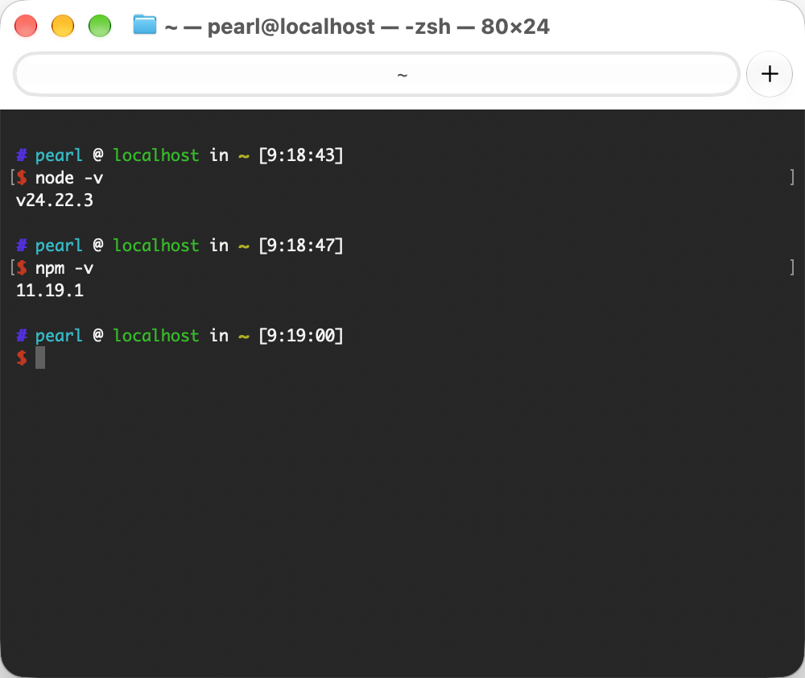

Windows 的 Git Bash 里提示 `bash: node: command not found` 时，按顺序处理：

1. 关掉所有 Git Bash 窗口，重新打开一个，再运行 `node -v`。安装 Node.js 之前打开的窗口识别不到新装的程序。
2. 在 VS Code 的内置终端里遇到这个提示时，关掉 VS Code 的所有窗口，再重新打开。只新建一个终端不起作用。
3. 仍然不行就重启电脑，再试一次。
4. 重启后还是找不到，在 Git Bash 里运行 `ls "/c/Program Files/nodejs"`。提示目录不存在，说明 Node.js 没有装上，重新安装。输出里有 `node.exe`，说明程序在，但它的目录没有加进 PATH。重新运行 Node.js 的安装程序，保持默认选项。

macOS 的终端里提示 `command not found: node` 时，关掉终端重新打开再试。


### 准备手机和网络

1. iPhone 或 iPad：系统为 iOS 14 以上，统一使用 Safari。iOS 通过 App Clip 进入 AR，功能与 Android 不完全相同。
2. Android 手机：系统为 Android 10 以上，安装 Chrome 浏览器。（Android 的流程还没有在真机上测试过。）
3. 华为鸿蒙手机：很可能进不了 WebAR，原因见下面的说明。先按第 4 步测一次，进不了的话和其他同学合作完成练习 5 和练习 6。
4. 用手机打开 Needle 的官方 AR 示例 <https://see-through-walls-zubcksz28jgxs.needle.run/>，点页面上的 AR 按钮，试试能否进入 AR。进入后能看到相机画面，说明这台手机可以用。
5. 让手机和电脑连到同一个 Wi-Fi。

关于鸿蒙手机：Android 上的 Chrome 要靠 Google 的 ARCore（Google Play Services for AR）才能进入 WebAR。2019 年以后的华为手机没有 Google 服务，一般装不了 ARCore。HarmonyOS NEXT（鸿蒙 5 及以后）不再兼容 Android 应用，也没有 Chrome。目前没有找到鸿蒙浏览器支持 WebXR AR 的官方说明。


### 注册 Needle 账号

每位同学需要注册并登录自己的 Needle 账号。课程练习属于非商业使用，不需要购买 Needle 许可证。

1. 用浏览器打开 <https://cloud.needle.tools/>，用邮箱注册一个个人账号，并按页面提示完成邮箱验证。
2. 记住注册用的邮箱和密码。练习 1 在 Unity 里导入 Needle Engine 之后，要用这个账号登录。


### 导入 Needle Engine 安装包的方法

安装包在课程资料的 `prerequisite/` 文件夹里，文件名是 `Install Needle Engine Unity Integration.unitypackage`，大小约 20 KB。导入后 Unity 会联网下载 Needle Engine 的包，所以导入时电脑需要联网。

导入需要先有一个打开的 Unity 项目。项目在练习 1 的第 1 到 4 步创建，创建好后回到这里操作。

1. 把安装包复制到电脑本地容易找到的位置，例如桌面。
2. 在已打开的 Unity 项目里，把安装包从文件管理器拖进 Unity 下方的 Project 窗口。也可以用菜单 `Assets > Import Package > Custom Package...`，选中安装包后点打开。
3. Unity 弹出 `Import Unity Package` 窗口。保持所有文件勾选，点右下角的 `Import`。
4. 等待安装和导入完成。期间可能弹出一个窗口，提示 `A new scoped registry is now available in the Package Manager.`。这是 Needle 的包源，直接关掉窗口即可。
5. 查看 Unity 顶部菜单栏。出现 `Needle Engine` 菜单，说明安装成功。

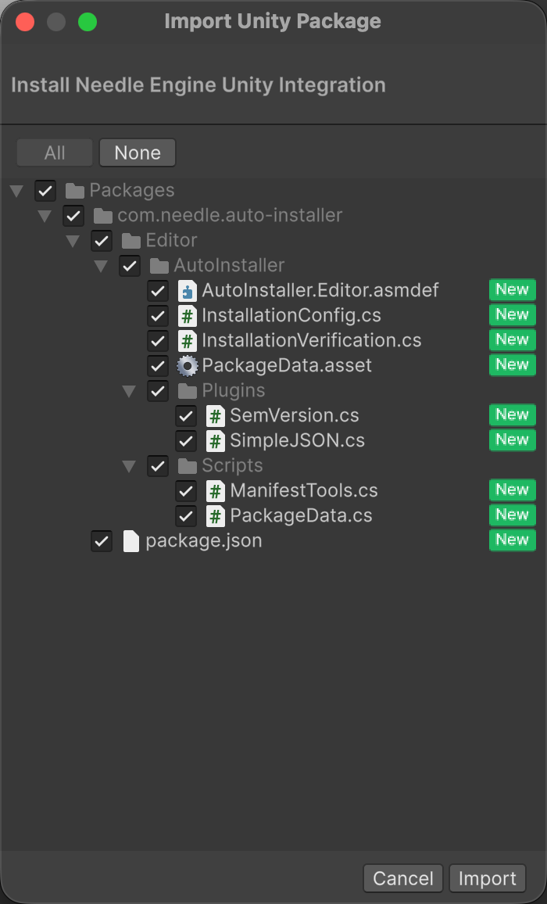

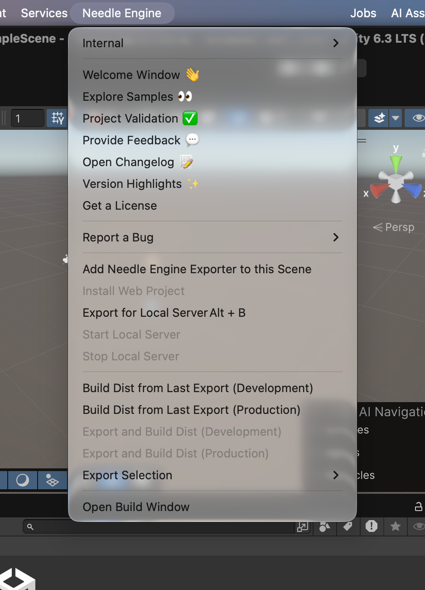

## 练习 1：创建项目与安装插件

1. 打开 Unity Hub，在左侧点 `Projects`，再点右上角的 `New project`。
2. 在窗口顶部确认 Editor Version 是 6.3 LTS。在模板列表里选 `Universal 3D`。
3. 在右侧填写 Project name，例如 `NeedleEngineTutorial`。Location 选一个只含英文和数字的路径，不要有中文和空格。Windows 上如果有OneDrive同步，不要放在桌面或“文档”里。可以放在 `C:\Users\你的用户名\UnityProjects`。用户名带中文或空格时，改用 `C:\UnityProjects`。
4. 点 `Create project`。首次创建需要几分钟。Unity 打开后，默认布局是左侧 Hierarchy，中间 Scene，右侧 Inspector，下方 Project。
5. 按上面“导入 Needle Engine 安装包的方法”的第 1 到 4 步导入安装包。
6. 确认顶部菜单栏出现 `Needle Engine`。


如果菜单没有出现：

1. 打开 `Window > General > Console`，查看有没有红色报错。
2. 检查网络，然后关闭 Unity，从 Unity Hub 重新打开项目。
3. 仍然没有就重新导入一次安装包。


## 练习 2：创建 Needle 场景

1. 在 Unity 顶部菜单选 `File > New Scene`。弹出 New Scene 窗口，左侧是场景模板列表。
2. 选一个名称里带 `(Needle)` 的模板。本练习统一选 `Minimal (Needle)`。
3. 点右下角的 `Create`。
4. 保存场景。如果 Unity 直接弹出保存对话框，就在 `Assets` 下新建 `Scenes` 文件夹，文件名填 `FirstWebAR`，点保存。如果没有弹出，选 `File > Save As...` 做同样的操作。
5. 确认 Hierarchy 窗口顶部的场景名显示为 `FirstWebAR`。
6. 在 Hierarchy 里逐个点击对象，同时看右侧 Inspector。找到 Inspector 里有 `Needle Engine` 组件的那个对象。
7. 在 Inspector 的 `Needle Engine` 组件里，用第 0 步注册的 Needle 个人账号登录。登录成功后继续下一步。（如果是网络问题：代理打开虚拟网卡TUN模式，关闭IPv6）
8. 查看该组件的 `Location` 字段。它是 Web 项目的目录，路径相对于 Unity 项目目录。

场景名会成为 Web 项目的目录名，所以先保存并命名场景，再做后面的预览。场景名只用英文和数字。

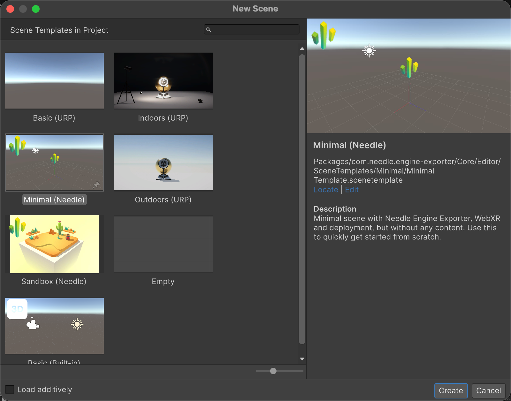

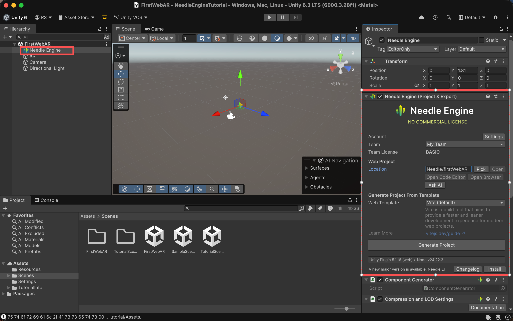


## 练习 3：添加一个物体

1. 在 Hierarchy 窗口的空白处点右键，选 `3D Object > Cube`。Hierarchy 里出现一个名为 `Cube` 的对象。名称保持 `Cube`，后面的部分会用到。
2. 选中 `Cube`，在 Inspector 的 `Transform` 里按 X, Y, Z 的顺序填值。Position 填 0, 0.1, 0。Rotation 填 0, 30, 0。Scale 填 0.2, 0.2, 0.2。
3. 把鼠标移到 Scene 视图里，按 `F` 键。视图会对准 `Cube`。
4. 新建材质。在 Project 窗口的 `Assets` 文件夹空白处点右键，选 `Create > Material`，命名为 `CubeMat`。
5. 选中 `CubeMat`。在 Inspector 里点 `Base Map` 旁边的色块，选一个容易辨认的颜色。如果项目用的是 Built-In 渲染管线，色块在 `Albedo` 旁边。
6. 把 `CubeMat` 从 Project 窗口拖到 Hierarchy 里的 `Cube` 上。Scene 视图里的 Cube 变成你选的颜色。
7. 点 Scene 视图上方的 `Game` 标签页。这里是相机看到的画面，确认能看到 Cube。看不到的话，回到 Scene 视图调整 Cube 或 `Main Camera` 的位置。
8. 按 `Ctrl+S`（macOS 是 `Cmd+S`）保存场景。

进入 AR 后，Unity 里的 1 个单位对应真实空间的 1 米。默认 Cube 的边长是 1 米，放在桌面上太大。Scale 设为 0.2 后边长是 20 厘米。Position 的 Y 设为 0.1，Cube 的底面正好落在高度为 0 的平面上。

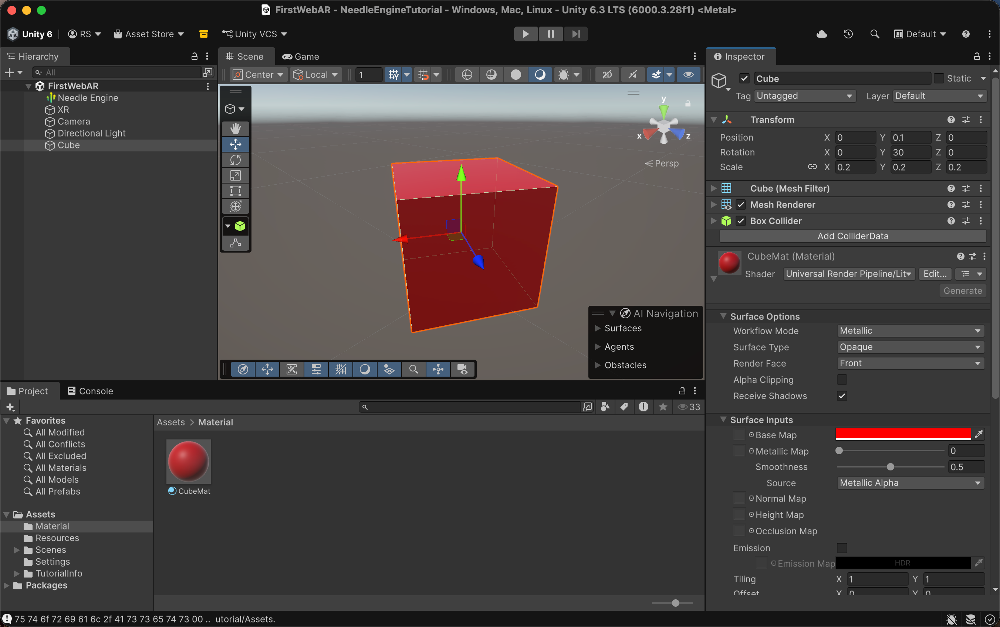


## 练习 4：在电脑浏览器预览

1. 在 Hierarchy 里选中带 `Needle Engine` 组件的对象，确认 `Location` 字段有值。
2. 点 Unity 顶部中间的 Play 按钮（三角形图标）。在 Needle 场景里，Play 的作用是安装并启动 Web 项目，画面出现在浏览器里。
3. 等待首次安装。第一次启动要下载依赖，可能需要几分钟。可以打开 `Window > General > Console` 查看进度。如果 Windows 弹出防火墙提示，询问是否允许 Node.js 访问网络，选择允许。
4. 默认浏览器会自动打开一个页面。地址形如 `https://192.168.0.123:3000`，开头是 `https`，后面是电脑的局域网 IP 和端口。
5. 浏览器首次打开会显示证书警告，原因是本地服务器使用自签名证书。点 `Advanced`（高级），再点 `Proceed`（继续前往）。Safari 点完后可能需要刷新一次页面。
6. 页面里应显示你的 Cube。
7. 回到 Unity，把 `CubeMat` 换一个颜色，按 `Ctrl+S` 或 `Cmd+S` 保存场景。再看浏览器，Cube 的颜色应随之变化。

网页预览成功只说明 3D 场景能在浏览器里运行。AR 要到练习 5 才加入。

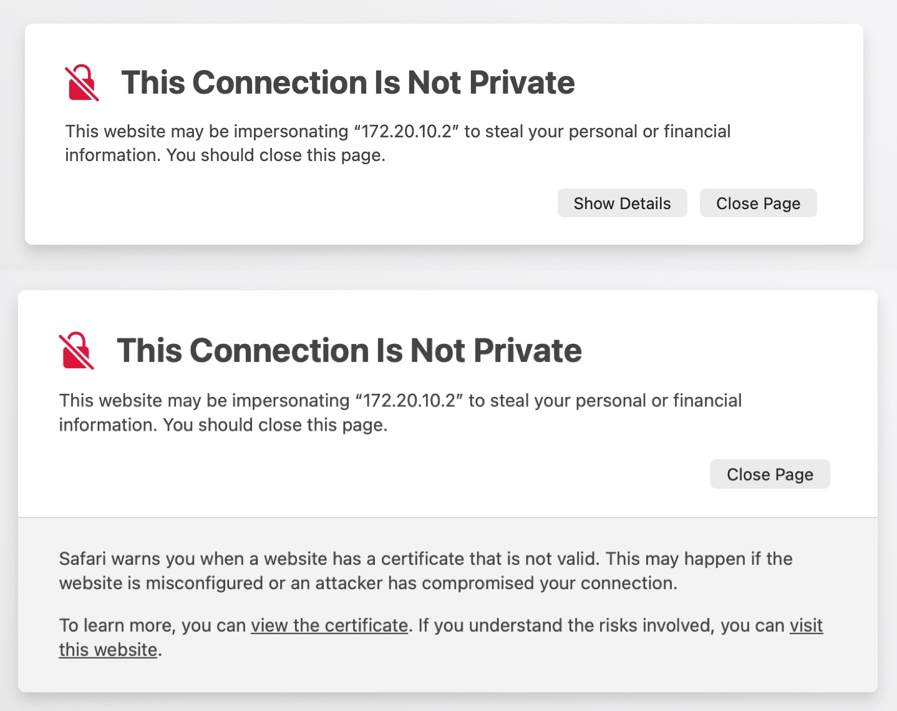

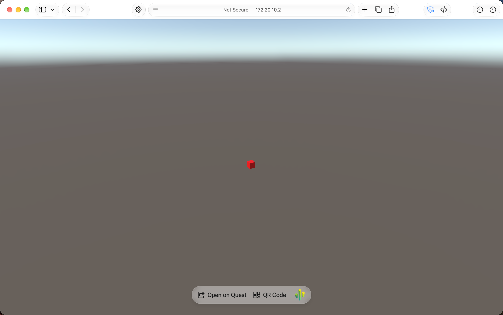

如果浏览器没有打开或页面空白：

1. 查看 Unity 的 Console 窗口有没有红色报错。
2. 打开终端（Windows 用 Git Bash，macOS 用“终端”），运行 `node -v`，确认 Node.js 已安装。提示 `node: command not found` 时，按“检查 Node.js 和 VS Code”一节的办法处理。
3. `node -v` 正常，Unity 的 Console 里仍然提示找不到 Node.js 时，关闭 Unity 和 Unity Hub，再重新打开。安装 Node.js 时已经开着的程序识别不到它。
4. 确认 `Location` 指向的目录存在。
5. 报错里出现端口被占用时，关闭其他正在运行的本地服务器，再点一次 Play。
6. Windows 上首次安装很久不结束，或 Console 的报错里有 `EPERM`、`EBUSY` 字样时，检查项目是否在 OneDrive 云盘同步的目录下。

## 练习 5：加入 AR 入口

1. 在 Hierarchy 的搜索框里输入 `t:WebXR`，检查场景里是否已经有 WebXR 组件。有的话清空搜索框，选中那个对象。
2. 在 WebXR 组件里确认创建 AR 按钮和创建二维码的选项已勾选，默认都是开启的。
3. 按 `Ctrl+S` 或 `Cmd+S` 保存场景，回到电脑浏览器查看页面。页面上应出现 Needle 的菜单，里面有 AR 入口和二维码按钮。
4. 让手机和电脑连到同一个 Wi-Fi。
5. 在电脑页面上点二维码按钮，用手机扫码打开页面。Android 用 Chrome 打开，iPhone 用 Safari 打开。也可以在手机浏览器里手动输入电脑浏览器地址栏中的完整地址。
6. 手机上同样会出现证书警告。Android 的 Chrome 里点“高级”，再点“继续前往”。iPhone 的 Safari 里点“显示详细信息”，再点“访问此网站”，然后刷新页面。
7. 手机页面显示 Cube 后，点 AR 入口按钮，在权限提示里允许使用相机。
8.  屏幕上出现真实环境的相机画面，说明已进入 AR。

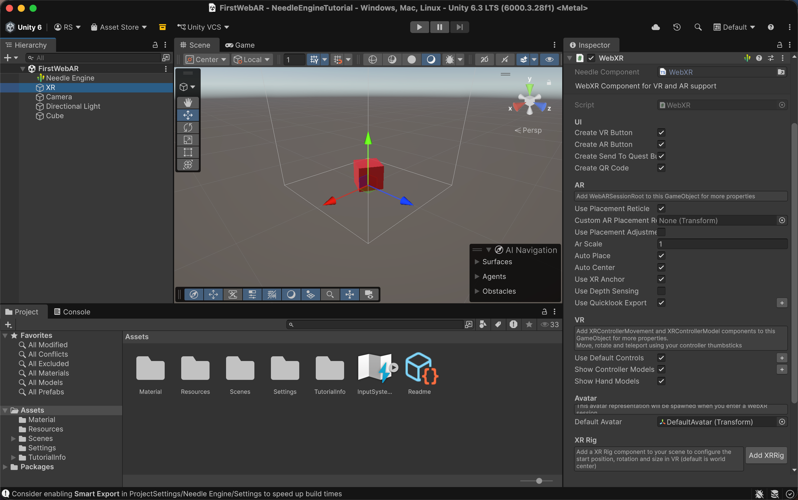

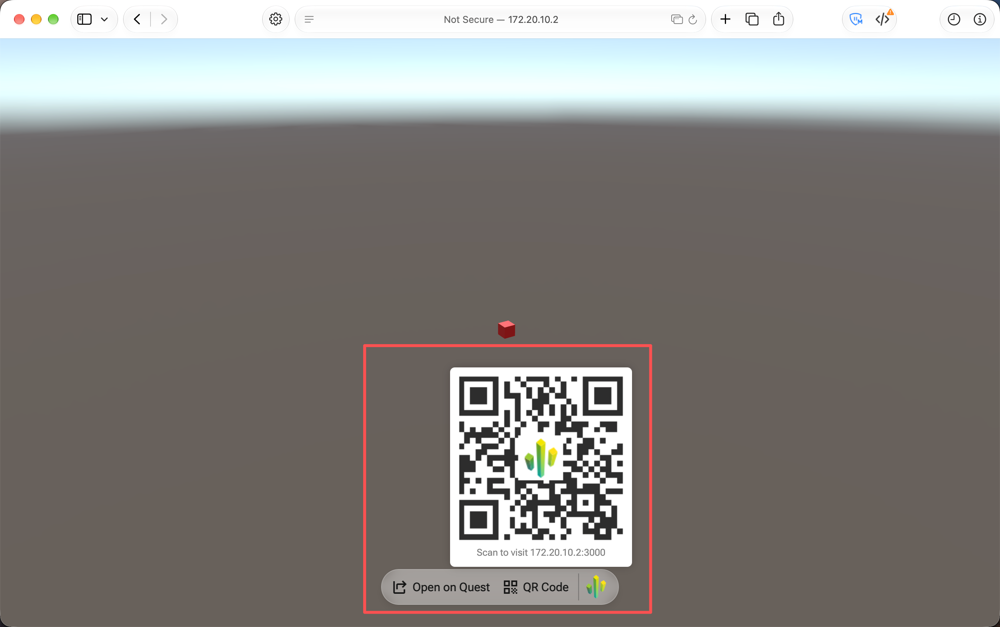


## 手机打不开时按顺序检查

1. 手机和电脑是否连到同一个 Wi-Fi。有些校园网和教室 Wi-Fi 不允许设备之间互相访问。遇到这种情况，让电脑连接手机热点后重新点 Play。
2. 手机上打开的地址是否和电脑浏览器地址栏里的一致。地址以 `https` 开头，中间是电脑的局域网 IP。`localhost` 指向设备自己，在手机上不能用。
3. 是否点过了证书警告页。课堂练习不需要在手机上安装证书。
4. 电脑防火墙是否拦截了 Node.js。Windows 上可以在弹出的防火墙提示里选择允许。
5. 页面能打开但没有 AR 入口，或点了没有反应时，检查手机系统版本和浏览器是否符合第 0 步“准备手机和网络”里的要求。
6. 自己的手机不支持时，和手机可用的同学合作完成练习 5 和练习 6，并记录自己手机的测试结果。


## 练习 6：观察并尝试放置

先在自己的 `FirstWebAR` 场景里体验放置，再打开官方示例对比。

WebXR 组件的 `AR` 一栏里有很多选项。这节课只看下面三个和放置有关的选项，其他选项保持默认。`Use XR Anchor` 在第 2 节课后的高级追踪自学部分会用到。

| 选项 | 作用 |
| --- | --- | 
| `Use Placement Reticle` | 进入 AR 后，在检测到的桌面或地面上显示放置指示器，提示可以放在哪里 |
| `Auto Place` | 检测到表面后自动把场景放到指示器的位置，不需要点屏幕 |
| `Use Placement Adjustment` | 放置后可以用单指或双指拖动，调整场景的位置、旋转和大小 |

放置的是整个场景，不是单个物体。场景里的 `Cube` 跟着场景一起移动。

这个练习改成点击放置，并允许放置后调整：

1. 回到 Unity，选中带 WebXR 组件的对象。
2. 在 Inspector 的 WebXR 组件里，`Use Placement Reticle` 保持勾选，取消勾选 `Auto Place`，勾选 `Use Placement Adjustment`。

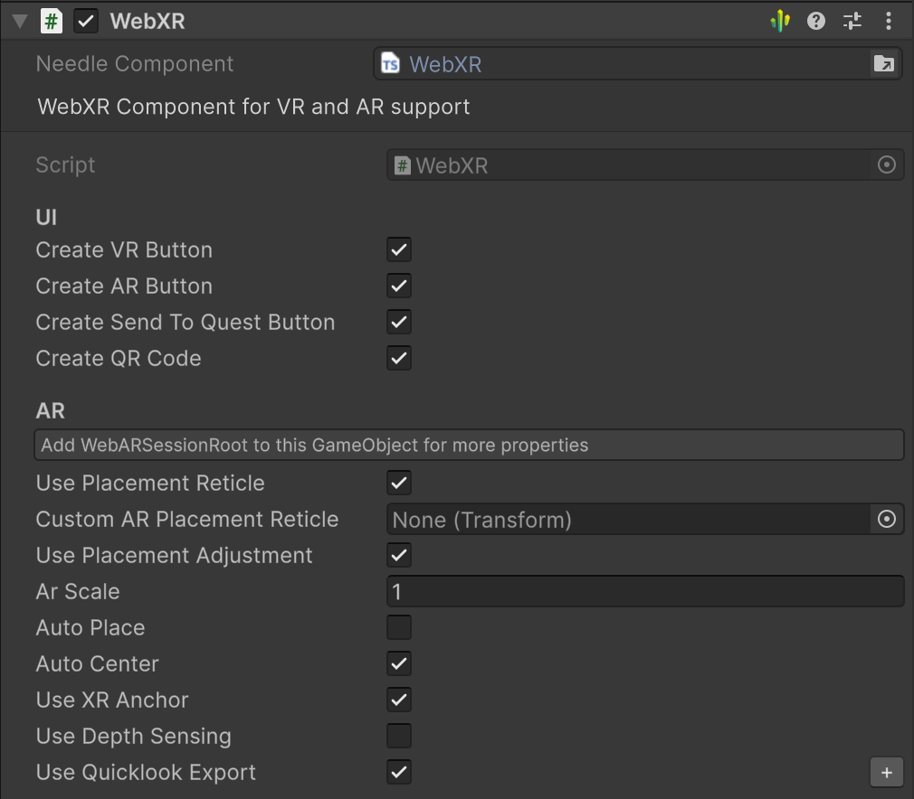

3. 按 `Ctrl+S` 或 `Cmd+S` 保存场景。
4. 按练习 5 的第 5 到 8 步在手机上打开页面并进入 AR。
5. 拿着手机缓慢移动，对准有纹理的桌面或地面。光线太暗或表面是纯色、反光的，检测会变慢。
6. 画面里出现放置指示器后，点一下屏幕。场景放到指示器所在的位置，Cube 出现在桌面上。

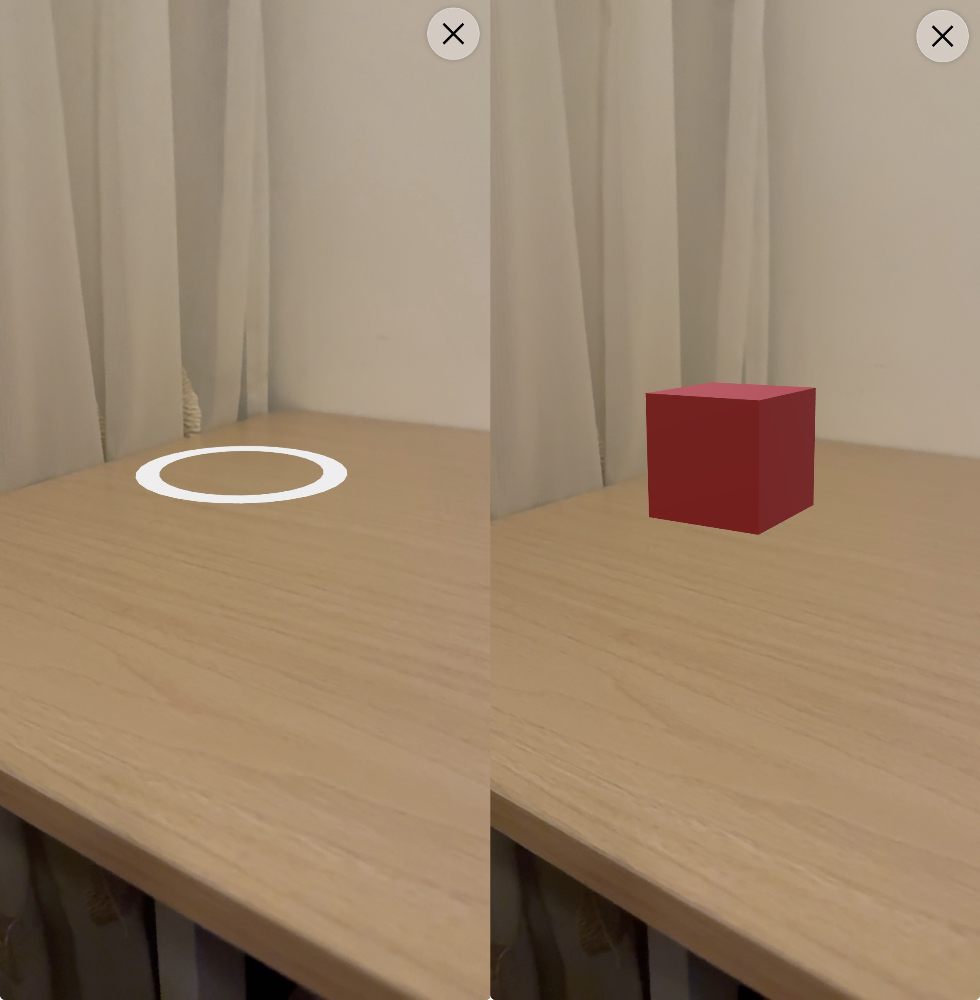

7. 放置后用单指或双指在屏幕上拖动，调整位置、旋转和大小。
8. 绕着 Cube 走动观察，看它是否留在原地。记下指示器在哪些表面出现得快，在哪些表面不出现。

后面两节课沿用这个设置。

调整 AR 中的大小：

1. 回到 Unity，选中带 WebXR 组件的对象。
2. 在 WebXR 组件的 `AR` 一栏找到 `Ar Scale`，默认值是 1。把它改为 2。
3. 保存场景，在手机上刷新页面，重新进入 AR 并放置。Cube 看起来应比之前小。数值越大，内容显得越小。
4. 试完后把数值改回 1 并保存。

打开官方示例对比：

1. 先按 `Ctrl+S` 或 `Cmd+S` 保存 `FirstWebAR`。
2. 在 Unity 顶部菜单选 `Needle Engine > Explore Samples`。
3. 在打开的窗口里点 `Install Samples`，等待示例下载完成。

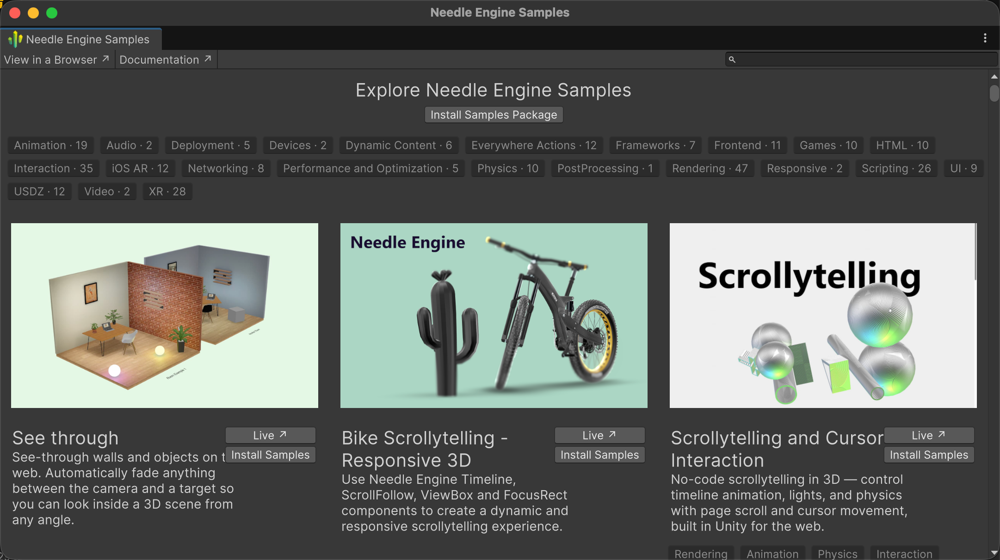

4. 选自己感兴趣的 AR 示例，点 `Open Scene`。
5. 点 Play，等待浏览器打开示例页面。示例有自己的 Web 项目，首次启动同样需要安装依赖。
6. 用手机打开示例页面，进入 AR，按示例的方式放置物体。
7. 回到 Unity，在 Hierarchy 里找到带 WebXR 组件的对象，在 Inspector 里查看它的选项。和自己的 `FirstWebAR` 对比，看哪些选项不同。
8. 看完后回到自己的场景。在 Project 窗口打开 `Assets/Scenes`，双击 `FirstWebAR`。


## 完成检查

1. Unity 项目能正常打开，顶部菜单栏有 `Needle Engine`。
2. `FirstWebAR` 场景已保存，里面有 `Cube` 和带 WebXR 组件的对象。
3. 点 Play 后，电脑浏览器能显示 Cube。
4. 已在手机上测试过一次，并记录了机型、系统版本、浏览器、能否进入 AR、能否放置。

## 课后

1. 调整 Cube 的大小、材质和位置，再在手机上测试一次。
2. 保留 Unity 项目和 `FirstWebAR` 场景。下节课会在 Cube 上添加点击交互。
