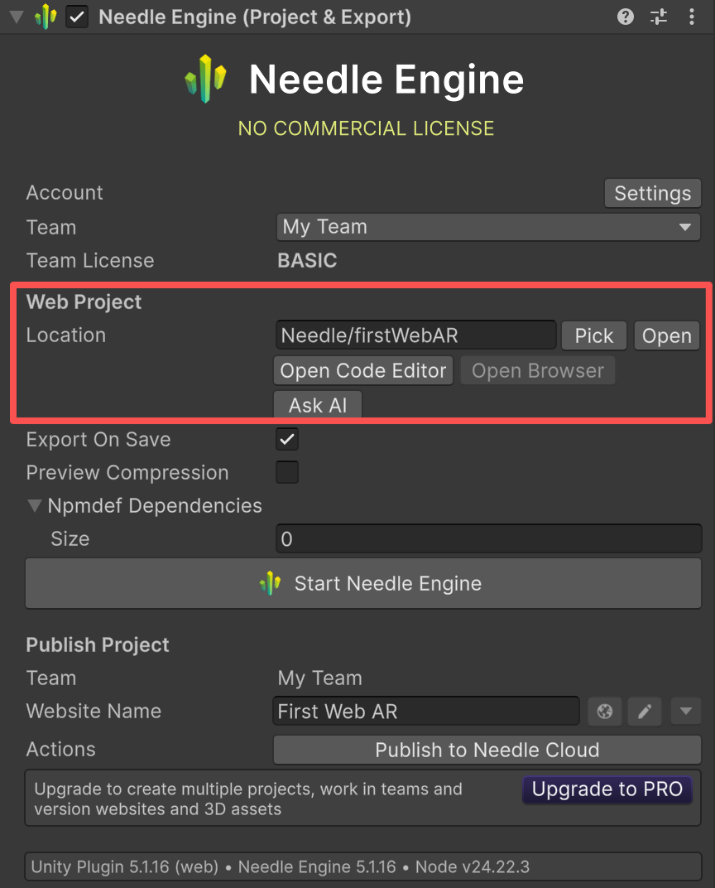
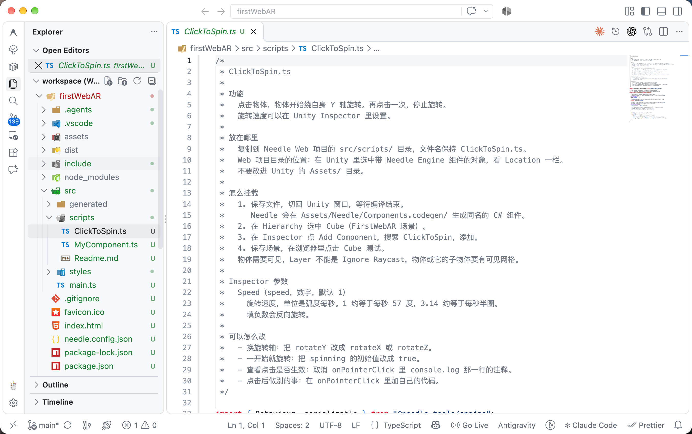
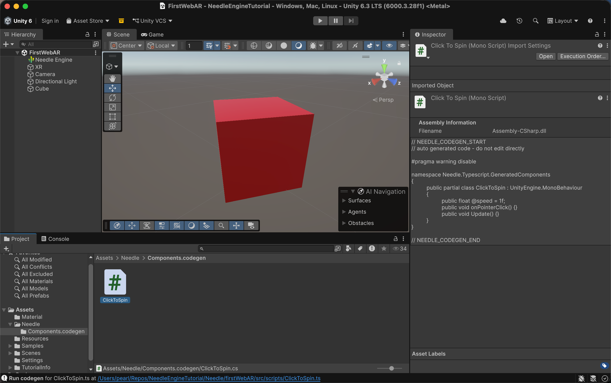
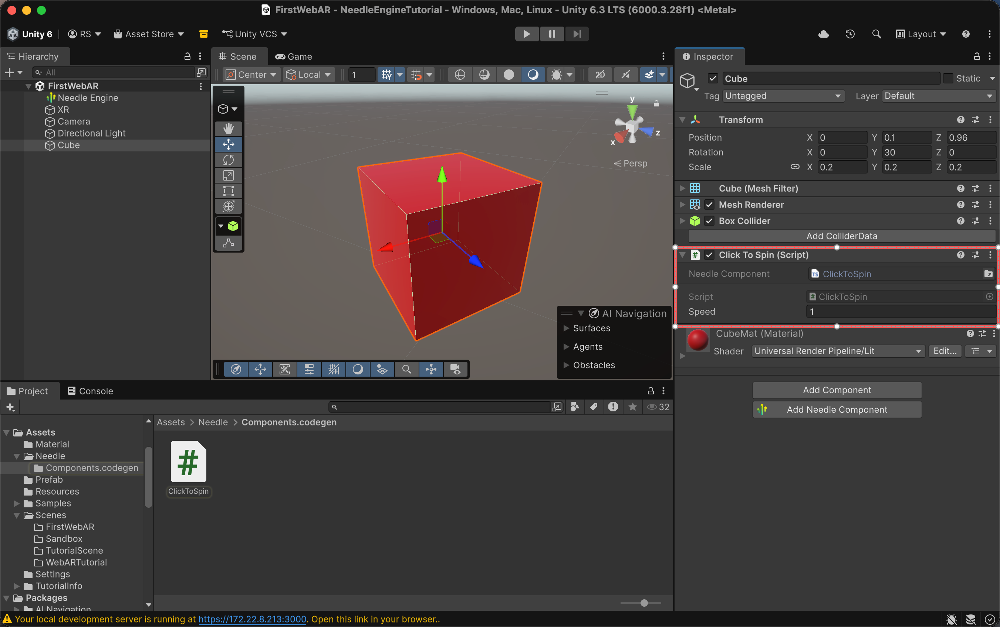
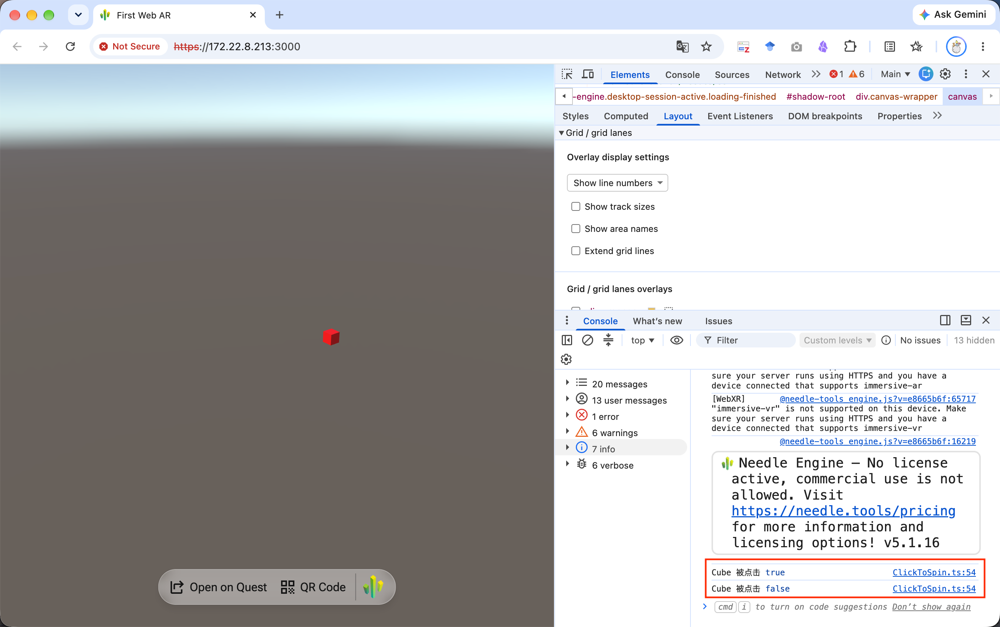
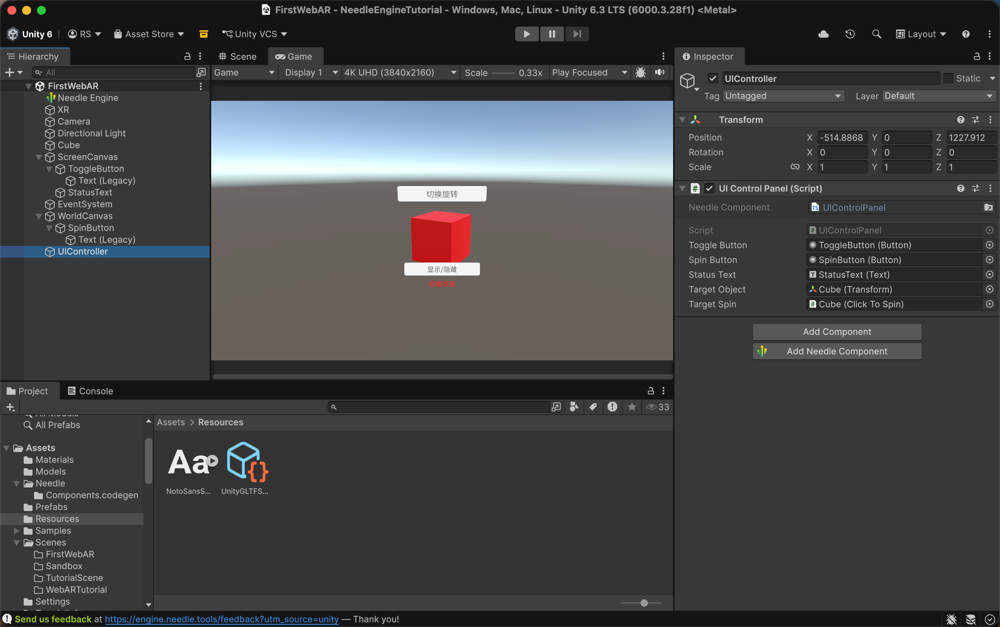
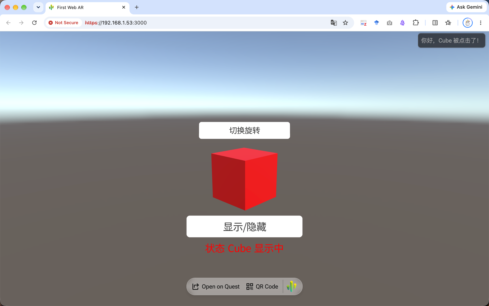
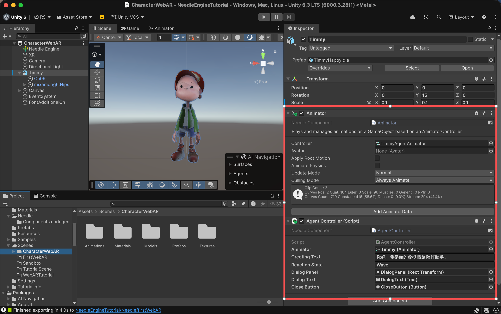
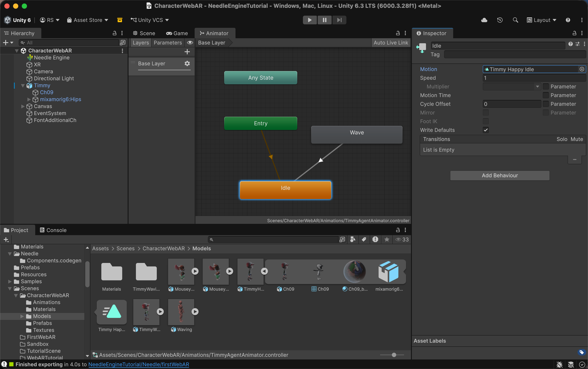

# 第 2 节课：用 TypeScript 给物体加交互

这一部分给第 1 节课的 Cube 加上点击交互。做完之后，在浏览器里点击 Cube，它开始旋转，再点一次停止。最后把同样的做法用到角色上。

用到的脚本都在课程资料的 [`scripts/`](scripts/) 目录里：

| 脚本 | 作用 | 挂在哪个物体上 |
|---|---|---|
| [`ClickToSpin.ts`](scripts/ClickToSpin.ts) | 点击后开始或停止旋转 | `Cube` |
| [`ClickToMessage.ts`](scripts/ClickToMessage.ts) | 点击后弹出提示消息（`showBalloonMessage`） | `Cube` |
| [`UIControlPanel.ts`](scripts/UIControlPanel.ts) | 用 UI 按钮控制物体显隐或旋转，并更新 UI 文字 | `Canvas` 或空物体 `UIController` |
| [`SnapToTarget.ts`](scripts/SnapToTarget.ts) | 配合 `DragControls`，拖动靠近目标时自动吸附（堆叠或戴帽子） | 被抓取的物体（`Cube2` / `Hat`） |
| [`AgentController.ts`](scripts/AgentController.ts) | 点击角色后显示问候语并播放动画 | 角色物体，或先用 `Cube` 测试 |

## 开始前检查

开始之前确认下面四项。有一项不满足，先回到[第 1 节课](tutorial-1-basic.md)补完。

1. Unity 里打开的是 `FirstWebAR` 场景，Hierarchy 里有 `Cube`。
2. 按过一次 Unity 顶部的 Play，浏览器里能看到 Cube。
3. 电脑上装好了 VS Code。
4. 下载好了GitHub课程资料里的 [`scripts/`](scripts/) 目录里的脚本。

## 区分 Unity 项目和 Web 项目

第 1 节课建的 `NeedleEngineTutorial` 里其实有两个项目。一个是 Unity 项目，一个是 Needle 生成的 Web 项目。这节课要在两个项目之间来回切换，先弄清它们各管什么。

| | Unity 项目 | Web 项目 |
| --- | --- | --- |
| 是什么 | 编辑场景的工程 | 在浏览器里运行的网页工程 |
| 用什么打开 | Unity Hub 和 Unity | VS Code |
| 在哪里 | 第 1 节课建项目时选的位置 | Needle Engine 组件的 `Location` 一栏，路径相对于 Unity 项目 |
| 里面主要有什么 | 场景、模型、材质、组件设置 | 网页代码、TypeScript 脚本、导出的场景文件 |
| 自己改什么 | 摆放物体、挂组件、填参数 | 写和修改 `src/scripts/` 里的 `.ts` 文件 |
| 在哪里运行和查看 | 在 Unity 编辑器里编辑和查看场景 | 点 Play 后，Needle 用 Node.js 启动一个本地服务器，把网页文件发给浏览器。网页代码在浏览器里运行，效果也在浏览器里查看 |

两个项目之间的数据是这样流动的：

1. 在 Unity 里保存场景，Needle 把场景导出到 Web 项目的 `assets/` 目录，浏览器加载这些文件显示场景。
2. 在 VS Code 里保存 `src/scripts/` 里的 `.ts` 文件，Needle 在 Unity 项目的 `Assets/Needle/Components.codegen/` 里生成一个同名组件，Unity 里才能 Add Component。
3. 在 Unity 里给组件填的参数，随场景一起导出，网页运行时由脚本读取。

所以 `.ts` 文件只放在 Web 项目的 `src/scripts/` 里，不要放进 Unity 的 `Assets/`。场景和组件参数只在 Unity 里改，不要去改 Web 项目里导出的文件。

两个项目合在一起的目录大致如下。Web 项目的实际位置以 `Location` 为准。

<pre><code><span style="color: #2563eb; font-weight: 700;">NeedleEngineTutorial/            Unity 项目，用 Unity Hub 打开</span>
├── Assets/                      场景、材质、模型。自己的资源放这里
│   ├── Scenes/FirstWebAR.unity
│   └── Needle/Components.codegen/   由 .ts 自动生成的组件，不要手动改
├── Packages/                    Unity 包的清单
├── ProjectSettings/             项目设置
├── Library/                     Unity 的缓存，可以重新生成
<span style="color: #2563eb; font-weight: 700;">└── Needle/firstWebAR/           Web 项目，用 VS Code 打开（以 Location 中的名称为准）</span>
    ├── package.json             网页工程的依赖清单
    ├── vite.config.js           Vite 构建与代理配置
    ├── tsconfig.json            TypeScript 配置
    ├── needle.config.json       Needle 配置文件
    ├── index.html
    ├── assets/                  Unity 导出的场景文件，不要手动改
    ├── dist/                    打包输出目录，不要手动改
    ├── include/                 引擎内置资源，不要手动改
    ├── node_modules/            第一次 Play 时下载的依赖，可以重新生成
    └── src/
        ├── main.ts
        ├── generated/           自动生成的文件，不要手动改
        ├── styles/              网页样式文件
        <span style="color: #dc2626; font-weight: 700;">└── scripts/             自己的 TypeScript 脚本放这里（自带 MyComponent.ts）</span></code></pre>

目录管理记住三条：

1. Web 项目留在 Unity 项目内（`Location` 默认位置），不要单独移走，备份时一起带走。
2. 从 Unity 的 `Needle Engine` 组件点 `Open Code Editor` 打开 Web 项目，不要手动用 VS Code 打开整个 Unity 项目，否则找不到 Needle 类型并报错。
3. 新建其他场景时检查 `Location`。脚本属于对应的 Web 项目，换了 Web 项目需要把脚本复制过去。

### 整理 src/scripts/ 里的脚本

脚本多了以后按功能建子文件夹（在 VS Code 里右键 `scripts > New Folder...`）：

```text
src/scripts/
├── interaction/      点击、拖动等交互，例如 ClickToSpin.ts
├── character/        角色动画与反应，例如 AgentController.ts
├── ui/               UI 控制脚本，例如 UIControlPanel.ts
├── ai/               AI 对话与声音，第 3 节课用到
└── tracking/         追踪与定位，进阶示例用到
```

命名与习惯：

1. 一个文件只写一个组件，文件名与 `export class` 后的类名一致（如 `ClickToSpin.ts` 对应 `export class ClickToSpin`）。
2. 只用英文字母和数字，不用空格和中文。文件名用大驼峰（如 `ClickToSpin`），文件夹名用小写（如 `interaction`）。
3. 先放好位置再 Add Component；挂好后再移动或改名 `.ts`，可能需要重新挂载。
4. 修改课程脚本前先复制一份副本，改坏时方便对照。

### 整理 Unity 的 Assets/

在 Project 窗口右键 `Assets > Create > Folder`，按素材类型分目录：

```text
Assets/
├── Scenes/       场景，例如 FirstWebAR
├── Materials/    材质，例如 CubeMat
├── Models/       导入的 3D 模型和角色
├── Textures/     图片和贴图
├── Animations/   动画和 Animator Controller
├── Audio/        声音文件
└── Prefabs/      可复用的Prefab预制体
```

注意三点：

1. 移动、改名、删除素材都在 Unity 的 Project 窗口里做，不要在系统文件管理器里操作，否则会丢失 `.meta` 引用。
2. `Assets/Needle/` 由 Needle 管理，不要往里放自己的素材或手动修改。
3. 导入的外部素材包保留原目录，只用英文和数字命名自己的素材。

## 第 1 步：找到 Web 项目目录

1. 在 Unity 的 Hierarchy 选中带 `Needle Engine` 组件的对象。
2. 在 Inspector 找到 `Needle Engine` 组件的 `Location` 一栏（例如 `Needle/firstWebAR`），路径相对于 Unity 项目目录。
3. 记下这个路径，后面复制脚本要用。



## 第 2 步：用 VS Code 打开 Web 项目

在 Unity 的 `Needle Engine` 组件上点 `Open Code Editor` 直接打开。

展开左侧的 `src`，应能看到 `scripts` 目录。没有的话，右键 `src` 选 `New Folder...` 新建一个。

## 基础练习：点击交互

本节练习包含两部分：第一部分用 [`ClickToSpin.ts`](scripts/ClickToSpin.ts) 让 `Cube` 点击后旋转；第二部分用 [`ClickToMessage.ts`](scripts/ClickToMessage.ts) 让 `Cube` 点击后弹出提示消息。

本课所有脚本都按下面 A–D 四步添加，后文简称“按通用流程添加脚本”。下面先以 `ClickToSpin.ts` 和 `Cube` 为例走一遍完整流程。

### 第一部分：ClickToSpin.ts（点击旋转）

#### A. 复制脚本到 src/scripts/ 的子文件夹

1. 打开课程资料的 [`scripts/`](scripts/) 目录，找到要用的脚本 [`ClickToSpin.ts`](scripts/ClickToSpin.ts)（它的内容和 slides 上的代码相同，多了中文注释）。
2. 复制到 Web 项目 `src/scripts/` 下对应的子文件夹（如 `src/scripts/interaction/`）。没有子文件夹就在 VS Code 里右键 `scripts > New Folder...` 新建。
   - 也可以自己动手写：在 VS Code 资源管理器里右键 `interaction` 文件夹，选择 `New File...`，输入 `ClickToSpin.ts`，然后照着 slides 输入代码。
3. 保持文件名不变（文件名、类名、组件名必须一致）。
4. 在 VS Code 打开该文件确认无误，按 `Ctrl+S`（macOS 为 `Cmd+S`）保存。

应该看到：VS Code 资源管理器的 `src/scripts/interaction/` 下出现 `ClickToSpin.ts`。



常见错误：

- 把脚本放进了 Unity 的 `Assets/` 目录。Unity 不识别 `.ts` 文件，组件不会生成。
- 把脚本放在 Web 项目的根目录或 `src/` 下，没有放进 `src/scripts/`。
- 文件名被系统改成了 `ClickToSpin.ts.txt` 或 `ClickToSpin 2.ts`。

在 VS Code 里读一遍 `ClickToSpin.ts`，对照下面的说明：

| 代码 | 含义 |
|---|---|
| `export class ClickToSpin extends Behaviour` | 定义一个叫 ClickToSpin 的组件 |
| `@serializable()` 和 `speed: number = 1` | 旋转速度，会出现在 Inspector 里，默认值是 1 |
| `private spinning = false` | 记录现在是否在旋转，一开始不旋转 |
| `onPointerClick()` | 物体被点击时运行，把旋转状态取反 |
| `update()` | 每一帧运行一次，状态是旋转时让物体转一点 |
| `this.speed * this.context.time.deltaTime` | 速度乘以这一帧经过的时间，转速不随帧率变化 |

`speed` 的单位是弧度每秒。`1` 约等于每秒转 57 度，`3.14` 约等于每秒转半圈。

### B. 等待 Unity 生成组件

Needle 会为每个 TypeScript 组件自动生成一个同名的 C# 文件。这个 C# 文件只是让组件能出现在 Unity 的 Inspector 里，网页运行的仍然是 TypeScript。

1. 切回 Unity 窗口。Unity 要回到前台才会开始导入。
2. 等待 Unity 右下角的进度图标结束。通常需要几秒到几十秒。
3. 在 Unity 的 Project 窗口，展开 `Assets/Needle/Components.codegen/`。
4. 确认里面出现了和脚本同名的文件，例如 `ClickToSpin`。
5. 看一眼 Unity 的 Console 窗口（菜单 `Window > General > Console`），确认没有红色报错。

应该看到：`Assets/Needle/Components.codegen/` 里有 `ClickToSpin`，Console 里没有红色报错。



如果等了一分钟还没有生成，按顺序尝试：

1. 回到 VS Code，确认文件在 `src/scripts/` 或它的子文件夹里，并且已经保存。
2. 在 Unity 里选中带 `Needle Engine` 组件的对象，在 Inspector 中取消勾选 `Component Generator` 组件并保存场景，再重新勾选该组件并保存，触发重新生成。
3. 回到 VS Code，在 `.ts` 文件中任意位置加一个空格再删掉，然后重新保存（`Ctrl+S` / `Cmd+S`），重新触发导入。
4. 确认 Web 项目已经安装过依赖。没有按过 Play 的话，先按一次 Play，等浏览器打开页面。
5. 关闭 Unity 再重新打开项目。

### C. 在 Unity 里 Add Component 并填参数

1. 在 Hierarchy 窗口点击要挂脚本的物体，这里点击 `Cube`。
2. 在 Inspector 窗口最下方点击 `Add Component`。
3. 在搜索框输入组件名 `ClickToSpin`，点击搜索结果里的同名组件。
4. 在新出现的 `Click To Spin` 组件里，把 `Speed` 设为 `1`（每个脚本的参数说明写在脚本文件开头的注释里）。
5. 按 `Ctrl+S`（macOS 是 `Cmd+S`）保存场景。不保存的话，网页不会更新。

应该看到：`Cube` 的 Inspector 里多出一个 `Click To Spin` 组件，下面有 `Speed` 一栏。Unity 会在组件名的单词之间自动加空格。



搜索不到组件时，回到 B 步检查组件是否已经生成。

### D. 在浏览器里测试与调试

1. 如果浏览器里的预览页面还开着，保存场景后等它自动刷新；如果已经关掉，按 Unity 顶部的 Play 重新打开，确认能看到 `Cube`。
2. 点击 `Cube`。应该看到 `Cube` 开始绕竖直方向的轴旋转。
3. 再点击一次 `Cube`。应该看到它停下来。
4. 点击 `Cube` 旁边的空白处。`Cube` 的状态不应该变化。
5. 回到 Unity，把 `Speed` 改成 `3`，保存场景。等网页刷新后再点击 `Cube`，转速应该变快。
6. 把 `Speed` 改成 `-1`，保存场景，再测试。`Cube` 应该反方向旋转。
7. 用手机打开第 1 节课里的手机访问地址，用手指点击 `Cube`，重复第 2 步和第 3 步。

两种修改的生效方式不同：

- 改 Inspector 里的参数：在 Unity 里保存场景，网页重新加载。
- 改 `.ts` 文件里的代码：在 VS Code 里保存文件，网页自动更新，不需要回 Unity。如果增删了 `@serializable` 参数，要切回 Unity 等它重新生成组件。

如果点击 `Cube` 没有反应，按顺序检查：

1. `ClickToSpin` 是否挂在 `Cube` 上，而不是挂在别的物体上。
2. `Cube` 在网页里是否可见。
3. `Cube` 的 Layer 是否是 `Ignore Raycast`。在 Inspector 右上角的 `Layer` 下拉框里查看，改回 `Default`。
4. `Cube` 是否还带着 `Mesh Renderer` 组件。点击检测针对可见的网格。
5. 浏览器的 Console 里有没有红色报错。打开方法见下面的调试步骤。

#### 用 Console 确认点击是否生效

1. 在 VS Code 里打开 `src/scripts/interaction/ClickToSpin.ts`。
2. 找到 `onPointerClick()` 里的这一行：

   ```typescript
   // console.log("Cube 被点击", this.spinning);
   ```

3. 删掉开头的 `// `，变成：

   ```typescript
   console.log("Cube 被点击", this.spinning);
   ```

   如果脚本是自己照着 slides 写的，就在 `this.spinning = !this.spinning;` 的下一行加上这一句。
4. 按 `Ctrl+S`（macOS 是 `Cmd+S`）保存。网页会自动更新。
5. 切到浏览器，打开开发者工具。Windows 按 `F12`，macOS 按 `Cmd+Option+I`。
6. 点击开发者工具顶部的 `Console` 标签。
7. 点击 `Cube`。

应该看到：每点击一次，Console 里多一行 `Cube 被点击 true` 或 `Cube 被点击 false`。



根据结果判断问题在哪里：

| 现象 | 可能的原因 | 怎么查 |
|---|---|---|
| 没有日志 | 点击没有命中物体，或组件没有挂上 | 回到上面的检查清单 |
| 有日志，Cube 不转 | `Speed` 是 0，或代码有错 | 检查 Inspector 里的 `Speed`，看 Console 里的红色报错 |
| Console 里有红色报错 | 代码写错了 | 对照 [`scripts/ClickToSpin.ts`](scripts/ClickToSpin.ts) 逐行检查 |

手机浏览器里看不到 Console。先在电脑浏览器里把问题解决，再到手机上测试。

调试结束后，可以把这一行重新注释掉。

### 第二部分：ClickToMessage.ts（点击弹出提示消息）

[`ClickToMessage.ts`](scripts/ClickToMessage.ts) 是另一个基础点击模板：点击 `Cube` 时，在浏览器 Console 打印日志，并在网页上方弹出一条提示消息（`showBalloonMessage`）。

1. 按通用流程的 A 步，把 [`scripts/ClickToMessage.ts`](scripts/ClickToMessage.ts) 复制到 Web 项目的 `src/scripts/interaction/`。
2. 按通用流程的 B 步，切回 Unity，等待 `ClickToMessage` 出现在 `Assets/Needle/Components.codegen/`。
3. 在 Hierarchy 窗口点击 `Cube`，在 Inspector 里点击 `Add Component`，搜索 `ClickToMessage` 并添加。
4. 在 `Click To Message` 组件里可以看到 `Message` 一栏，可以改成自己想显示的提示文字。
   - 如果 `Cube` 上还挂着 `ClickToSpin`，点击时两个脚本都会运行（一边旋转一边弹消息）。不想要旋转的话，右键点击 `Click To Spin` 组件的标题栏，选择 `Remove Component`。
5. 保存场景，等网页刷新。
6. 在浏览器里点击 `Cube`，观察网页上方弹出提示消息，同时 Console 里出现对应的日志。

## 扩展：用 UI 组件控制场景

前面都是直接点击 3D 物体。实际做 AR 应用时，经常需要屏幕上或空间里的按钮、文字提示，例如"显示/隐藏模型"或"开始旋转"。这一节使用 Unity 自带的 UI 组件（Canvas、Button、Text），由 Needle 导出到网页里运行。

### 两种 Canvas

| 类型 | 显示位置 | 适用场景 | 进入手机 AR 后 |
|---|---|---|---|
| `Screen Space - Overlay` | 固定贴在屏幕画面上，类似 2D 按钮 | 开关按钮、状态文字、操作面板 | 保持在手机屏幕前（在部分设备或模式下可能受限） |
| `World Space` | 放在 3D 空间里，和模型在同一个世界坐标 | 贴在角色旁边的说明牌、空间菜单 | 留在真实空间中，随相机移动和遮挡 |


### 第 1 步：添加两种不同的按钮（含中文字体与朝向相机）

这一步先在场景里同时放好一个 `Screen Space - Overlay` 按钮和一个 `World Space` 按钮，并把中文字体与朝向相机一次性配好，后面两步直接复用这两个按钮。

#### 1. 创建屏幕按钮与空间按钮

1. 先调整相机视角：在 Hierarchy 选中 `Camera`，把 `Transform` 设为 Position `0, 0.4, -1`、Rotation `15, 0, 0`、Scale `1, 1, 1`，从略微俯视的角度看到 `Cube`。
2. 创建 `Screen Space - Overlay` 按钮：在 Hierarchy 空白处右键，选择 `UI > Legacy > Button`。Unity 会同时创建 `Canvas`（改名为 `ScreenCanvas`）、`EventSystem` 和 `Button`（可改名为 `ScreenButton`）。
3. 选中 `ScreenCanvas`，确认 `Render Mode` 为 `Screen Space - Overlay`。把 `Canvas Scaler` 的 `UI Scale Mode` 改成 `Scale With Screen Size`（`Reference Resolution` 设为 `1080 x 1920`、`Match` 设为 `0.5`）。然后选中它下面的 `ScreenButton`（不要改 `ScreenCanvas` 自身的 `Rect Transform`，它由 Canvas 自动锁定），把锚点设为 `bottom-center`（底部居中）、`Pos X` 设为 `0`、`Pos Y` 设为 `140`、`Scale` 设为 `2, 2, 2`，按钮文字改成"隐藏"。
4. 创建 `World Space` 按钮：在 Hierarchy 空白处右键选择 `UI > Canvas`，命名为 `WorldCanvas`。把它的 `Render Mode` 改成 `World Space`，`Width` / `Height` 设为 `200` / `100`，`Scale` 改成 `0.005, 0.005, 0.005`，位置放到 `Cube` 旁边（例如 `0.4, 0.2, 0`；如果手机竖屏 AR 里视野偏窄，可改放到 `Cube` 正上方近处 `0, 0.28, 0`）。
5. 右键 `WorldCanvas` 选择 `UI > Legacy > Button`（可改名为 `WorldButton`），把按钮的 `Scale` 设为 `0.5, 0.5, 0.5`，按钮文字改成"显示"。

#### 2. 配置中文字体（`Legacy Text`）

在 Needle 里使用 Unity UI 文字时，按下面步骤配置字体，避免网页里出现空白或方块：

1. **使用 `UI > Legacy > Text`**：不要用 `TextMeshPro`（TMP）。Needle 核心 UI 导出依赖 Legacy Text，TextMeshPro 默认不会按预期显示。
2. **换成课程提供的静态中文字体**：Unity 默认的 `LegacyRuntime.ttf` 不包含中文字形。编辑器里会借用系统字体显示，但 Needle 导出到网页后会变成空白。
   - 把课程资料 [`prerequisite/`](prerequisite/) 里的 `NotoSansSC-Regular.ttf` 拖进 Unity 的 `Assets/Fonts/`（如需自己找字体，注意用静态单字重 `.ttf`，不要用文件名带 `VariableFont` 的可变字体，Needle 的 MSDF 图集生成器容易烘焙失败）。
   - 在 Hierarchy 里选中**每一个**需要显示中文的 `Text (Legacy)`（注意 `ScreenCanvas` 和 `WorldCanvas` 下的按钮各自有自己的 `Text` 子物体），把 `NotoSansSC-Regular` 拖进 Inspector 的 `Font` 一栏。
3. **补充字符（`FontAdditionalCharacters`）**：Needle 导出时默认只扫描场景里静态写好的汉字来打包 MSDF 字体图集，动态修改的文字或新增汉字容易漏烘。在场景中任意物体（例如 `WorldCanvas` 或 `UIController`）上 `Add Component` 添加 `FontAdditionalCharacters`，把会用到的汉字全部贴进去（例如 `显示隐藏切换旋转状态中已`）。

如果加上 `FontAdditionalCharacters` 后网页里还是显示不出来，按下面顺序处理：

- **直接删掉 Web 项目的 `assets/` 重新生成**：停止 Unity Play，打开 `Needle Engine` 组件 `Location` 指向的 Web 项目目录，删掉里面的 `assets/` 文件夹（必要时也一并删掉 Unity 项目里的 `Library/Needle/FontCache~` 和 `Library/Needle/FontCharsets~`），回到 Unity 保存场景（`Ctrl+S` / `Cmd+S`）并重新点 Play，让 Needle 从头生成字体图集，再在浏览器按 `Ctrl+Shift+R`（macOS 为 `Cmd+Shift+R`）强刷。
- **英文能显示、中文不显示**：检查对应按钮下的 `Text (Legacy)` 是否漏换了 `Font` 栏位。
- **`World Space` 按钮连英文也看不到**：选中按钮下的 `Text (Legacy)`，把 `Pos Z` 改成 `-1`（避免和按钮背景图在同一平面互相遮挡），并把 `Horizontal Overflow` 和 `Vertical Overflow` 设为 `Overflow` 防止文字被裁切。

#### 3. 给 `WorldCanvas` 添加 `LookAt`（朝向相机）

选中 `WorldCanvas`，在 Inspector 点击 `Add Component`，搜索 `LookAt`（Needle 内置组件）并添加，把 Hierarchy 里的 `Camera` 拖入 `Target` 一栏（如果进入 AR 后文字依然左右反了，勾选组件上的 `Invert`，或者把 `WorldButton` 的 `Rotation Y` 设为 `180`）。

> **为什么要加 `LookAt`**：Unity UI `Canvas` 的正面默认只朝向 `-Z`。进入 AR 后，用户拿着手机绕到侧面或背面时，由于 Needle 的文字材质默认双面渲染，从背面看过去会导致按钮文字左右镜像反过来。加上 `LookAt` 让 `WorldCanvas` 始终面向相机，无论在 AR 里从哪个方向看，文字都是正的。

### 第 2 步：无代码方式，用内置 `On Click ()` 连接按钮

如果只是做一个简单的固定开关，可以不写代码，直接用 Unity Inspector 自带的 `On Click ()`：

1. 选中 `ScreenCanvas` 下的 `ScreenButton`（"隐藏"按钮），在 Inspector 找到 `On Click ()` 列表，点击右下角的 `+` 号添加一项。
2. 把 Hierarchy 里的 `Cube` 拖进左下角的物体槽位，右侧函数下拉框选择 `GameObject > SetActive (bool)`，**取消勾选**后面的复选框（点击后隐藏 `Cube`）。
3. 选中 `WorldCanvas` 下的 `WorldButton`（"显示"按钮），同样在 `On Click ()` 点 `+` 拖入 `Cube`，选择 `GameObject > SetActive (bool)`，这次**勾选**后面的复选框（点击后重新显示 `Cube`）。
4. 保存场景并在浏览器测试：点屏幕上的"隐藏"按钮让 `Cube` 消失，再点 3D 空间里的"显示"按钮让它重新出现。

这种方式适合一次性的固定操作，但无法在一个按钮里实现"点一下隐藏、再点一下显示"的来回切换，也无法动态修改文字。需要切换状态和改文字时，用下面第 3 步的 TypeScript 做法。

### 第 3 步：添加代码，用 `UIControlPanel.ts` 控制物体并更新文字

[`UIControlPanel.ts`](scripts/UIControlPanel.ts) 在课程资料的 [`scripts/`](scripts/) 目录里。它把两个 UI 按钮和一个状态文字连到 `Cube` 上：点第一个按钮切换 `Cube` 的显示和隐藏，点第二个按钮切换 `Cube` 的旋转，同时把当前状态写进屏幕上的 `Text`。

这里直接复用上面建好的两个 Canvas：

1. 先把上面第 2 步里在两个按钮 `On Click ()` 列表添加的项删掉（选中对应项点右下角 `-` 号），避免和脚本逻辑冲突。
2. 把 `ScreenCanvas` 下的按钮改名为 `ToggleButton`（文字改为"显示/隐藏"），再右键 `ScreenCanvas` 选择 `UI > Legacy > Text` 建一个状态文本改名为 `StatusText`（记得同样换成 `NotoSansSC-Regular` 字体），把它的 `Rect Transform` 设为：`Pos X` 为 `0`、`Pos Y` 为 `-220`、`Width` 为 `160`、`Height` 为 `30`、`Scale` 为 `2, 2, 2`（保持默认 `center/middle` 锚点）。
3. 把 `WorldCanvas` 下的按钮改名为 `SpinButton`（文字改为"切换旋转"）。
4. 按通用流程的 A 步，把 [`scripts/UIControlPanel.ts`](scripts/UIControlPanel.ts) 复制到 Web 项目的 `src/scripts/ui/`（在 VS Code 里右键 `scripts` 新建 `ui` 文件夹）。
5. 按通用流程的 B 步，切回 Unity，等待 `UIControlPanel` 出现在 `Assets/Needle/Components.codegen/`。
6. 因为按钮分别在两个 Canvas 下，在 Hierarchy 新建一个空物体 `UIController` 来挂脚本（`Create Empty`）。
7. 在 Inspector 点 `Add Component`，搜索 `UIControlPanel`，点击添加。
8. 按下表把 Hierarchy 里的物体拖入 `UI Control Panel` 组件的栏位：

   | 参数 | 拖入什么 | 说明 |
   |---|---|---|
   | `Toggle Button` | `ScreenCanvas` 下的 `ToggleButton` | 屏幕空间按钮，切换显隐 |
   | `Spin Button` | `WorldCanvas` 下的 `SpinButton` | 3D 空间按钮，切换旋转 |
   | `Status Text` | `ScreenCanvas` 下的 `StatusText` | 显示当前状态的 Legacy Text |
   | `Target Object` | `Cube` | 控制显隐的目标物体 |
   | `Target Spin` | `Cube` | 拖入后自动识别 `Cube` 上的 `ClickToSpin` 组件 |

9. 保存场景，等网页刷新。



9. 在电脑浏览器里点击"显示/隐藏"按钮，观察 `Cube` 是否消失和重新出现，`StatusText` 是否跟着变成"状态：Cube 已隐藏"和"状态：Cube 显示中"。
10. 点击"切换旋转"按钮，观察 `Cube` 是否开始旋转或停止。




如果按钮点下去没有反应，按顺序检查：

1. Hierarchy 里有没有 `EventSystem` 物体。删除了 `EventSystem` 会导致所有 UI 按钮无法响应点击。
2. 按钮是否被 `StatusText` 或其他透明 UI 面板挡住。可以在不需要接收点击的 `Text` 组件上取消勾选 `Raycast Target`。
3. `Toggle Button` 和 `Target Object` 栏位是否都已经拖入，浏览器 Console 里有没有黄色警告。

## 扩展：用 DragControls 抓取并堆叠物体

除了点击按钮，Needle Engine 还自带 **`DragControls`** 组件，可以直接在电脑浏览器（鼠标）、手机网页和 AR 里抓取并拖动特定物体。

这里做一个"把两个并排的 Cube 堆叠起来"的小扩展：`DragControls` + 距离吸附脚本 `SnapToTarget.ts`

1. 在 Hierarchy 空白处右键 `3D Object > Cube`，命名为 `Cube2`。把它的 Transform 设为 Position `0.2, 0.05, 0`、Rotation `0, 30, 0`、Scale `0.1, 0.1, 0.1`（和原来的 `Cube` 并排放在一起，可顺便换一个材质颜色方便区分）。
2. 选中 `Cube2`，在 Inspector 点击 `Add Component`，搜索 **`DragControls`** 并添加（只有挂了 `DragControls` 的物体才能被抓取，原来的 `Cube` 保持不动）。
3. 按通用流程的 A 步，把 [`scripts/SnapToTarget.ts`](scripts/SnapToTarget.ts) 复制到 Web 项目的 `src/scripts/interaction/`。
4. 按通用流程的 B 步，切回 Unity，等待 `SnapToTarget` 出现在 `Assets/Needle/Components.codegen/`。
5. 选中 `Cube2`，点击 `Add Component` 添加 **`SnapToTarget`**，按下面填写参数：

   | 参数 | 填什么 | 说明 |
   |---|---|---|
   | `Target` | 从 Hierarchy 拖入 `Cube` | 要叠上去的目标方块 |
   | `Snap Distance` | `0.05` | 靠近到 0.05 米内自动吸附 |
   | `Offset Y` | `0.15` | `Cube` 半高 0.1 米加 `Cube2` 半高 0.05 米，正好叠在正上方 |

6. 保存场景，在浏览器里用鼠标（或手机手指）拖动 `Cube2` 靠近 `Cube`，观察 `Cube2` 自动吸附到 `Cube` 正上方完成堆叠。

## 练习：角色回应点击与戴帽子


### 新建角色练习场景

1. 在 Unity 顶部菜单选择 `File > New Scene`，选中 `Minimal (Needle)` 模板，点击 `Create`。
2. 按 `Ctrl+S`（macOS 为 `Cmd+S`）保存到 `Assets/Scenes/`，命名为 `CharacterWebAR`。
3. 在 Hierarchy 选中带 `Needle Engine` 组件的物体，把 `Location` 一栏改回现有的 Web 项目目录（例如 `Needle/firstWebAR`）。这样可以直接复用已安装好依赖和脚本的 Web 项目，不用重新下载依赖。
4. 选中场景里的 `Camera`，把视角调整到方便观察全身角色的位置（例如 Position `0, 0.9, -2`、Rotation `10, 0, 0`）。

### 换成带动画的角色（结合 UI 弹窗）

下面从 Mixamo 下载一个带动画的角色模型放进 `CharacterWebAR` 场景，并用 `Canvas`、`Text` 和 `Button` 做一个可手动关闭的问候语弹窗。
#### 从 Mixamo 下载角色和动画

1. 打开 [Mixamo](https://www.mixamo.com/)，使用免费的 Adobe 账号登录。
2. 点击顶部的 `Characters`，选择一个带贴图的角色（本示例用 `Timmy`，也可以选其他喜欢的人物模型；注意 `X Bot` / `Y Bot` 本身是灰白素模），确认右侧预览窗口已加载出模型。
3. 点击顶部的 `Animations`，在搜索框输入 `Waving`，选择一个挥手动画，确认右侧角色开始预览挥手动作。
4. 点击右上角的 `Download` 按钮，在弹窗中确认以下设置：
   - `Format`：`FBX for Unity (.fbx)`
   - `Skin`：`With Skin`（确保角色模型和动画一起导出）
   - `Frames per Second`：`30`（默认）
   - `Keyframe Reduction`：`none`（默认）
5. 点击 `Download`，保存下载得到的 `.fbx` 文件。

#### 在 Unity 里导入角色并配置动画

1. 把下载好的 `.fbx` 文件拖进 Unity 的 Project 窗口（建议放进 `Assets/Models/` 目录）。如果模型放进场景后还是灰色的，在 Project 窗口选中该 `.fbx` 文件，在 Inspector 的 `Materials` 标签页先点击 `Extract Textures...`，再点击 `Extract Materials...` 即可恢复颜色与贴图。
2. 把模型从 Project 窗口拖进 Hierarchy 窗口，放进 `CharacterWebAR` 场景。调整位置和大小，让它出现在相机画面里。
3. 在 Project 窗口的空白处右键，选择 `Create > Animation > Animator Controller`，命名为 `AgentAnimator`。
5. 在 Animator 窗口的空白处右键，选择 `Create State > Empty`。在 Inspector 里把它的名字改成 `Idle`。第一个创建的状态是橙色的，表示默认状态。
6. 在 Project 窗口展开角色模型，找到挥手的动画片段（Mixamo 导出的片段通常叫 `mixamo.com` 或 `Waving`），把它拖进 Animator 窗口。这会新建一个状态。
7. 点击这个新状态，在 Inspector 里把名字改成 `Wave`。名字要和 `Reaction State` 里填的完全一致，区分大小写。
8. 在 Animator 窗口右键点击 `Wave`，选择 `Make Transition`，再点击 `Idle`。这样挥手播完后会回到 `Idle`。
9. 在 Hierarchy 窗口点击角色物体。如果 Inspector 里没有 `Animator` 组件，点击 `Add Component` 添加一个。
10. 把 Project 窗口里的 `AgentAnimator` 拖到 `Animator` 组件的 `Controller` 一栏。

#### 连接可关闭的 UI 对话弹窗

1. 新建 `Canvas`（Hierarchy 右键 `UI > Canvas`，`Canvas Scaler` 设为 `Scale With Screen Size`、`1080 x 1920`），再右键 `Canvas` 选择 `UI > Panel`，命名为 `DialogPanel`（调整大小和位置到画面下方，避免挡住角色）。
2. 在 `DialogPanel` 下右键创建 `UI > Legacy > Text`（命名为 `DialogText`）和 `UI > Legacy > Button`（命名为 `CloseButton`，把按钮文字改成 `关闭` 或 `×`），记得把两者的 `Font` 都换成 `NotoSansSC-Regular`。
3. 按通用流程的 A、B 步，把 [`scripts/AgentController.ts`](scripts/AgentController.ts) 复制到 Web 项目的 `src/scripts/character/`，切回 Unity 等待编译完成。

   | 参数 | 拖入什么 | 说明 |
   |---|---|---|
   | `Animator` | 角色物体自身 | 自动识别上面的 `Animator` 组件 |
   | `Greeting Text` | 默认问候语 | 点击角色后显示在弹窗里的文字 |
   | `Reaction State` | `Wave` | 必须和 Animator 里的状态名完全一致 |
   | `Dialog Panel` | `DialogPanel` | 运行时默认隐藏，点击角色后显示 |
   | `Dialog Text` | `DialogText` | 自动填入 `Greeting Text` 的内容 |
   | `Close Button` | `CloseButton` | 点击后隐藏 `DialogPanel` |

6. 保存场景，等网页刷新。
7. 在浏览器里点击角色，确认角色挥手并弹出 `DialogPanel`；再点击弹窗上的关闭按钮，确认弹窗隐藏。

应该看到：角色播放挥手动画，画面弹出带关闭按钮的问候语面板，Console 里有 `点击了角色`。





点击角色没有播放动画时，按顺序检查：

1. Console 里有没有 `点击了角色`。没有的话，点击没有命中，回到前面 D 步的检查清单。
2. Console 里有没有“没有找到 Animator”的警告。有的话，检查 `Animator` 一栏是否已经拖入角色。
3. `Reaction State` 里的名字和 Animator 窗口里的状态名是否完全一致。
4. 角色物体或它的子物体是否有可见的网格。

### 给角色戴上自定义头饰/帽子

这一步把前面的 `DragControls` 和 [`SnapToTarget.ts`](scripts/SnapToTarget.ts) 用到角色身上：在角色旁边放一个自己喜欢的头饰或迷你模型，拖动它靠近角色头顶时，脚本会自动把它"戴"到角色头部骨骼上，之后角色播放挥手动画时，它还会跟着头部一起动。

1. 准备头饰/小模型（命名为 `Hat`）：可以自己用 Unity 的基础几何体拼一个小帽子，也可以导入外部 3D 模型或迷你角色（本示例用缩小后的 `Mousey` 站在 `Timmy` 头顶）。
2. 调整 `Hat`（如 `Mousey`）的大小和位置，使其比例适配角色头部，并摆在角色左侧或右侧的桌面上（例如 `Position` 设为 `-0.35, 0.1, 0`）。
3. 选中 `Hat`，在 Inspector 点击 `Add Component`，添加 **`DragControls`**（如果是多个基础几何体拼成的组合，把它们放进同一个父物体 `Hat` 下，只给父物体挂 `DragControls` 和 `SnapToTarget`）。
4. 再次点击 `Add Component`，添加 **`SnapToTarget`**。
5. 在 Hierarchy 中展开从 Mixamo 导入的角色模型骨架，找到它的头部骨骼（通常叫 `mixamorig:Head` 或 `Head`）。
6. 选中 `Hat`，按下面填写 `Snap To Target` 的参数：

   | 参数 | 填什么 | 说明 |
   |---|---|---|
   | `Target` | 从 Hierarchy 拖入角色的头部骨骼（如 `mixamorig:Head`） | 吸附的目标位置 |
   | `Snap Distance` | `0.25` | 靠近头部 0.25 米内自动戴上 |
   | `Offset Y` | `0.18` | 沿头部向上偏移，让头饰落在头顶而不是陷进脑袋里（按实际模型大小微调） |
   | `Attach To Target` | **勾选** | 吸附后把 `Hat` 设为头部骨骼的子物体，随角色动画一起运动 |

7. 保存场景，在浏览器里拖动 `Hat` 靠近角色头顶，确认头饰自动吸到头顶；再点击角色触发 `Wave` 动画，观察头饰是否跟着角色一起动。

### 可以怎么改

- 换问候语：改 Inspector 里的 `Greeting Text`，保存场景。
- 换动作：在 Animator 窗口里加一个新状态，把 `Reaction State` 改成新状态的名字。
- 让别的脚本控制角色：在别的脚本里调用 `triggerReaction("状态名")`。第 3 节课的 AI 智能体会用到这种做法。

完成这一步后，在 Unity 里保存场景。Web 项目目录不要删除，第 3 节课会继续使用。

## 常见问题

| 问题 | 处理方法 |
|---|---|
| `Add Component` 里搜不到组件 | 确认脚本在 Web 项目的 `src/scripts/` 或它的子文件夹里，并且已保存。切回 Unity 等待编译。仍然没有就在 `Needle Engine` 组件上取消勾选 `Component Generator` 保存后再勾选保存，或在 `.ts` 文件中加删空格重新保存，必要时重启 Unity。 |
| 改了参数，网页没有变化 | 在 Unity 里保存场景。确认本地服务器还在运行，必要时再按一次 Play。 |
| 改了代码，网页没有变化 | 确认 VS Code 里的文件已保存。看浏览器 Console 有没有红色报错。 |
| Cube 转得太快或几乎不动 | `Speed` 的单位是弧度每秒，先用 `1` 到 `3` 之间的数值。 |
| 手机上无法测试 | 先在电脑浏览器里确认交互正常。再按第 1 节课的清单检查网络、HTTPS 和设备支持。 |

参考文档：

- [Needle：创建 TypeScript 组件](https://engine.needle.tools/docs/how-to-guides/scripting/create-components)
- [Needle：输入事件](https://engine.needle.tools/docs/reference/api/input-events)
- [Needle：Unity UI（Canvas、Button、Text）](https://engine.needle.tools/docs/features-overview/ui)
- [Needle：Animator API](https://engine.needle.tools/docs/api/Animator)
