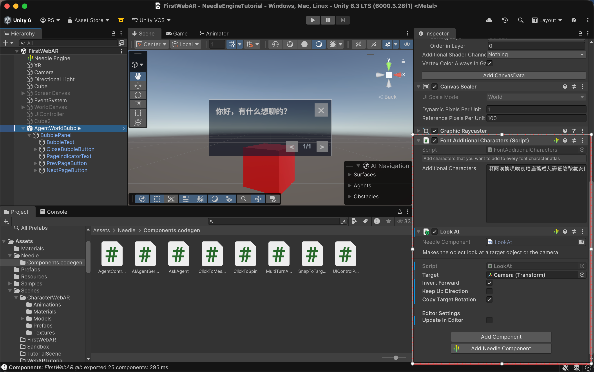
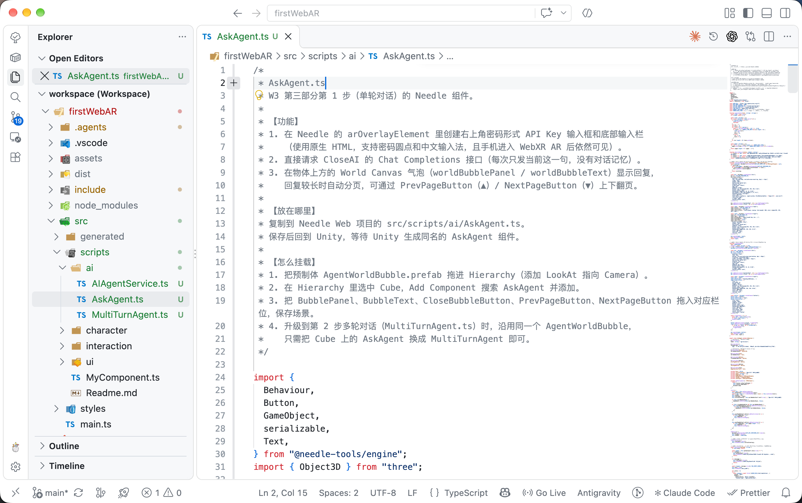
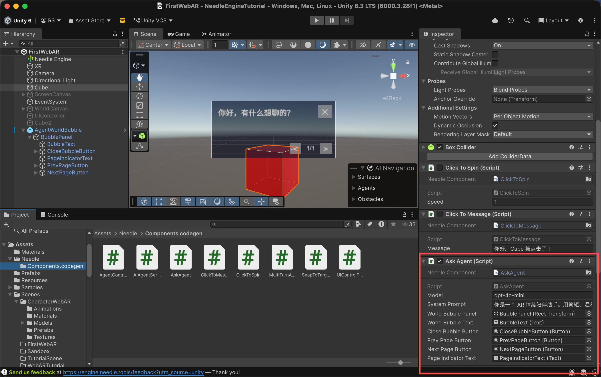
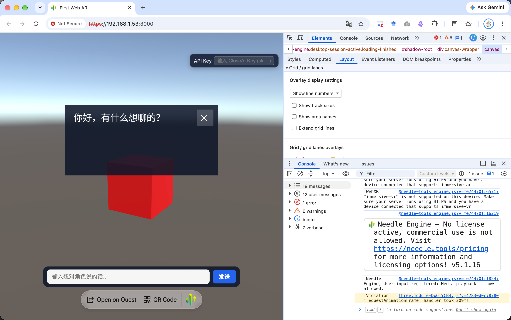
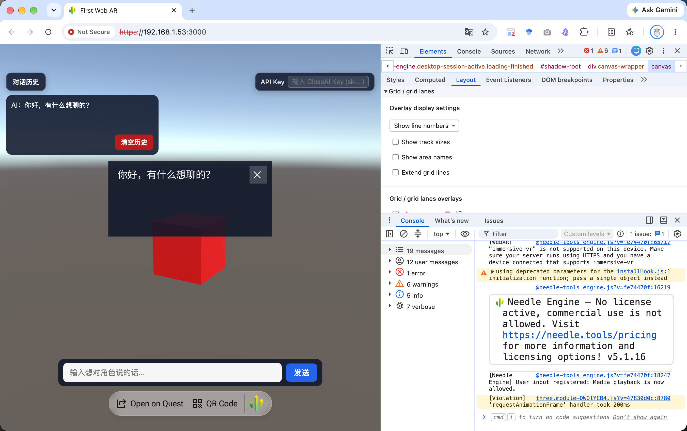
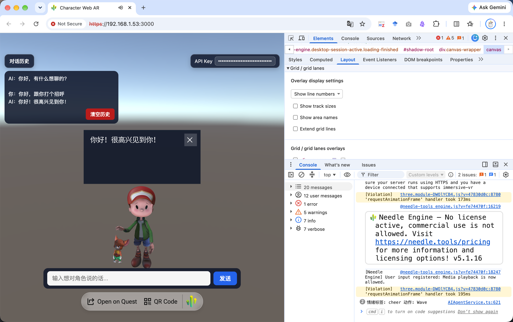

# 第 3 节课：AI 智能体，让 AR 角色回应你

这一部分介绍 AI 在 TypeScript 中的调用，将以第六次课的聊天机器人为基础，用同一个 CloseAI API Key。整节课通过 Needle 的 `arOverlayElement`（右上角 `type="password"` 密码 Key 框 + 底部紧凑输入栏，以及第 2 步左上角可折叠滚动的 `History` 面板）与 Unity UI 3D 气泡（`AgentWorldBubble.prefab`）配合完成交互，在电脑浏览器和手机 WebXR AR 里都能直接使用：

1. **课堂第 1 步（单轮对话，`AskAgent.ts`）**：在右上角填入 Key，用底部输入框和物体上方气泡完成单轮问答（无记忆）。
2. **课堂第 2 步（多轮对话，`MultiTurnAgent.ts`）**：沿用同一个 `AgentWorldBubble`，把 `Cube` 上的组件换成 `MultiTurnAgent`，开启最近 6 轮上下文记忆，并在左上角展开、滚动查看及清空历史记录。
3. **练习（带动画的角色，`AIAgentService.ts`）**：把 AI 接到第 2 节课的 `CharacterWebAR` 角色上，让回复带上情绪标签、角色动作和语音朗读。

用到的文件都在课程资料的 [`scripts/`](scripts/) 和 [`prefabs/`](prefabs/) 目录里：

| 文件 | 作用 | 放在哪里 | 怎么用 |
|---|---|---|---|
| [`AgentWorldBubble.prefab`](prefabs/AgentWorldBubble.prefab) | `World Space` 气泡面板预制体（在物体上方显示最新回复） | Unity 的 `Assets/Prefabs/` | 拖进 Hierarchy，并添加 `LookAt`（全程共用） |
| [`AskAgent.ts`](scripts/AskAgent.ts) | 课堂第 1 步（单轮对话）：生成 Key 框与底部输入栏，在气泡显示回复 | Web 项目的 `src/scripts/ai/` | 挂在 `Cube` 上 |
| [`MultiTurnAgent.ts`](scripts/MultiTurnAgent.ts) | 课堂第 2 步（多轮对话）：增加 6 轮上下文记忆与左上角可滚动 `History` 面板 | Web 项目的 `src/scripts/ai/` | 替换 `Cube` 上的 `AskAgent` |
| [`AIAgentService.ts`](scripts/AIAgentService.ts) | 练习（角色集成）：返回情绪标签和动作名，驱动角色动画并朗读 | Web 项目的 `src/scripts/ai/` | 挂在 `CharacterWebAR` 的角色上 |

课程资料的 [`scripts/`](scripts/) 目录和 Web 项目的 `src/scripts/` 目录是两个地方。前者是老师发的资料，后者在你自己的 Web 项目里。脚本要从前者复制到后者。

## 先看整体：两段连接

请求从网页出发，直接到模型服务。

1. Needle 网页：在右上角密码框填写 Key，采集底部输入框的用户文字，请求 CloseAI，在物体上方的 3D 气泡里显示回复。
2. 模型服务：生成回复文本。本练习使用 CloseAI，和第六次课相同。

## 和第六次课的关系

第六次课里，你已经用 Python 调用过大语言模型：在 CloseAI 创建了 API Key，把 client 改成了 CloseAI 的地址。这一部分调用同一个模型服务，用同一个 Key、同一个接口地址 `https://api.openai-proxy.org/v1`、同一个模型 `gpt-4o-mini`，只是换成由 AR 网页里的 TypeScript 发起请求。

| | 第六次课（Python） | 课堂第 1 步（`AskAgent.ts`） | 课堂第 2 步（`MultiTurnAgent.ts`） |
|---|---|---|---|
| 接口地址 | `OpenAI(api_key=..., base_url="https://api.openai-proxy.org/v1")` | `fetch("https://api.openai-proxy.org/v1/chat/completions", ...)` | 同左 |
| Key | 在 Streamlit 网页侧边栏粘贴 | 右上角 `type="password"` 密码框填写 | 同左 |
| 请求模型 | `client.chat.completions.create(model=..., messages=...)` | 请求体里写 `model` 和 `messages` | 同左 |
| 取出回复 | `response.choices[0].message.content` | `data.choices[0].message.content` | 同左 |
| 对话记忆 | `st.session_state.messages` 保存了之前的对话 | 单轮：每次只发当前一句，无记忆 | 多轮：保留最近 6 轮上下文，并在左上角展示历史 |

想改角色的说话方式时，可以参考彦君老师发的资料《OpenAI提示词工程9条最佳实践》，改组件的 `System Prompt` 参数。

## 开始前检查

确认下面四项。有一项不满足，先补完再继续。

1. 第 2 节课已经完成。Unity 里打开的是 `FirstWebAR` 场景，Hierarchy 里有 `Cube`（`Position: 0, 0.1, 0`、`Scale: 0.2, 0.2, 0.2`），点 Play 后浏览器里能看到 `Cube`。
2. 把第 2 节课练习留下、当前不用的 UI 与物体（`ScreenCanvas`、`WorldCanvas`、`UIController`、`Cube2`）在 Hierarchy 中选中并取消勾选激活（Deactivate），避免界面重叠或报错。
3. 能在 Unity 的 `Needle Engine` 组件上点 `Open Code Editor` 打开 Web 项目。
4. 手里有第六次课里创建的 CloseAI API Key（形如 `sk-...`），账号里还有余额，且电脑网络能访问 `https://api.openai-proxy.org`。找不到 Key 时，登录 [https://platform.closeai-asia.com/dashboard](https://referer.shadowai.xyz/r/1066098) 查看或重新创建一个。

测试时只输入虚构的内容，不要输入个人隐私。

### 安全说明

真实线上项目通常会把 API Key 放在后端服务端，由后端代为转发请求；为了课堂上无需搭建后端就能快速跑通，这一部分直接在页面右上角的密码输入框（`type="password"`）里由用户填写自己的 Key：

1. **网页 JS 里没有 API Key**：代码和打包后的网页 JavaScript 里都不包含任何 Key，可以把前端页面分享给别人或部署到静态网站，每个人填写自己的 Key。
2. **只在当前页面内存里保存**：输入的 Key 不会写入代码或本地磁盘，刷新或关闭浏览器标签页就会清除。
3. **使用时的注意事项**：请求会从你的浏览器直接发给 CloseAI，在自己浏览器的开发者工具 Network 面板里仍能看到请求头里的 Key。不要在公共电脑上忘记关闭页面，也不要把包含请求头的 Network 截图发给别人。

## 准备第 1 步气泡 UI（拖入预制体）

课程资料 [`prefabs/`](prefabs/) 目录里提供了物体上方气泡预制体 [`AgentWorldBubble.prefab`](prefabs/AgentWorldBubble.prefab)（`Position: 0, 0.3, -0.15`，`Scale: 0.002, 0.002, 0.002`，`Width: 260, Height: 120`），包含 `BubblePanel`、`BubbleText`、右上角 `CloseBubbleButton`（`×`）以及右下角翻页控件 `PrevPageButton`（`<`）、`PageIndicatorText`（`1/1`）、`NextPageButton`（`>`）。右上角密码 Key 框与底部输入框会由脚本自动挂载到 Needle 的 `arOverlayElement` 中，无需在 Unity 里另外搭输入栏。

操作步骤：

1. 在 Unity Project 窗口新建 `Assets/Prefabs/` 目录，把 [`AgentWorldBubble.prefab`](prefabs/AgentWorldBubble.prefab) 拖进去，再把它拖进 Hierarchy 根目录。
   - **Unity 6 坐标提示**：如果拖进 Hierarchy 后发现 `Pos X / Pos Y / Pos Z` 变成了很大的数字（没有使用预制体预设的 `0, 0.3, -0.15`），打开菜单 `Unity > Settings... > Scene View`（Windows 为 `Edit > Preferences... > Scene View`），勾选 **`Use prefab asset position when dropping on the Hierarchy window`**，再重新拖入即可直接保留预制体坐标。
2. 选中 `AgentWorldBubble`，`Add Component` 添加 `LookAt`，把 Hierarchy 里的 `Camera` 拖到 `Target` 一栏（让气泡在 AR 里始终朝向相机）。
3. **中文字体设置**：Needle 导出 `Legacy Text` 默认用 `Arial` 会缺少汉字。选中 `BubblePanel / BubbleText` 以及 `CloseBubbleButton`、`PrevPageButton`、`NextPageButton`、`PageIndicatorText` 下的 `Text`，把 `Font` 都换成 `NotoSansSC-Regular`（注意不要漏掉 `BubbleText`）。预制体根节点 `AgentWorldBubble` 已经自带 `FontAdditionalCharacters` 组件并预填了 [`prerequisite/common-chinese-chars.txt`](prerequisite/common-chinese-chars.txt) 的 6763 个常用汉字与标点，无需手动复制粘贴（首次点 Play 烘焙字体图集需要二三十秒，之后会走缓存）。

AgentWorldBubble 手动搭建参考参数（点击展开）

| 物体 | 所属 Canvas | 锚点 / 对齐 | 位置与大小 | 关键组件 |
|---|---|---|---|---|
| `AgentWorldBubble` | `World Space` | `Center` | `Pos: (0, 0.3, -0.15)`，`Width: 260, Height: 120`，`Scale: (0.002, 0.002, 0.002)` | `Canvas`、`LookAt` |
| `BubblePanel` | `AgentWorldBubble` | `Stretch` | 铺满父物体 | `Image` |
| `BubbleText` | `BubblePanel` | `Stretch` | 留出右侧关闭按钮与内边距 | `Text (Legacy)` |
| `CloseBubbleButton` | `BubblePanel` | `Top-Right` | `Pos: (-8, -8)`，`Size: (28, 28)` | `Button` |

## 第 1 步：单轮对话（AskAgent.ts）

### 1. 复制脚本并等待 Unity 生成组件

1. 在 Unity 的 `Needle Engine` 组件上点 `Open Code Editor` 打开 Web 项目。
2. 把课程资料 [`scripts/AskAgent.ts`](scripts/AskAgent.ts) 复制到 Web 项目的 `src/scripts/ai/AskAgent.ts`（先在 `src/scripts/` 下新建 `ai` 文件夹）。不要改文件名。
3. 切回 Unity 窗口等待编译结束，在 Project 窗口展开 `Assets/Needle/Components.codegen/` 确认出现 `AskAgent`，Console 里没有红色报错。

### 2. 把 AskAgent 挂到 Cube 上并连线

1. 在 Hierarchy 窗口点击 `Cube`，`Add Component` 搜索并添加 `AskAgent`。
2. 如果 `Cube` 上还挂着第 2 节课的 `ClickToSpin`，先取消勾选它，避免点击时影响测试。
3. 按下表填写和拖入参数：

| 参数 | 拖入什么 | 说明 |
|---|---|---|
| `Model` | `gpt-4o-mini` | 留空时默认使用 `gpt-4o-mini` |
| `System Prompt` | 角色设定 | 留空时使用默认情绪陪伴助手设定 |
| `World Bubble Panel` | `AgentWorldBubble / BubblePanel` | 启动时自动隐藏，收到回复后显示 |
| `World Bubble Text` | `BubblePanel / BubbleText` | 显示本次回复（超出自动分页） |
| `Close Bubble Button` | `BubblePanel / CloseBubbleButton` | 点击关闭气泡 |
| `Prev Page Button` | `BubblePanel / PrevPageButton` | 多页回复时向上翻页（`<`） |
| `Next Page Button` | `BubblePanel / NextPageButton` | 多页回复时向下翻页（`>`） |
| `Page Indicator Text` | `BubblePanel / PageIndicatorText` | 右下角页码显示（如 `1/2`） |

4. 按 `Ctrl+S`（macOS 是 `Cmd+S`）保存场景，点击顶部的 Play 打开预览页面。

### 3. 测试单轮对话

1. 在页面右上角的 `API Key` 密码框里粘贴或输入你的 CloseAI API Key（形如 `sk-...`），输入时会显示为圆点，不会明文展示。
2. 在屏幕底部输入框写一句虚构的日常问题，例如 `"今天有点累，怎么放松一下？"`，按回车或点击 `发送`。
3. 等待片刻，应该看到 `Cube` 上方的 `AgentWorldBubble` 弹出并显示回复（先显示 `正在思考…`，随后变成模型回复；回复较长时会自动分页，可点气泡右下角 `<` / `>` 翻页）。点击气泡右上角的 `×` 可以关闭；下次点 `发送` 时气泡会重新显示 `正在思考…`。

4. 试着再发一句 `"我刚才说了什么？"`——因为第 1 步没有对话记忆，模型不知道你上一句说了什么。
5. 用手机扫描预览二维码并进入 AR：确认右上角的 `API Key` 密码框、底部输入框和 `Cube` 上方气泡在 AR 画面中依然正常显示并可输入。

### 请求失败时检查

在浏览器按 `F12`（macOS 为 `Cmd+Option+I`）打开开发者工具，看 Network 里 `completions` 的状态码和 Console 里以 `AskAgent 请求失败` 开头的一行：

| 现象 | 可能的原因 | 处理 |
|---|---|---|
| 气泡提示"请先在右上角输入框填写 CloseAI API Key" | 右上角 `API Key` 还是空的，或刷新页面后清空了 | 重新粘贴你的 CloseAI Key（`sk-...`） |
| 气泡提示"Key 无效（401）" | Key 填错了，或者不是 CloseAI 的 Key | 重新复制粘贴，注意不要多带空格 |
| 气泡提示"请求被限制（429）" | 余额不足或请求太频繁 | 登录 CloseAI dashboard 查看余额，稍后再试 |
| 气泡提示"网络错误" | 电脑/手机网络访问不到 `api.openai-proxy.org` | 检查网络连通性 |
| Console 报错提到 model（如 `DEFAULT_MODEL is not support`） | `Model` 一栏写错 | 把 `Model` 改回 `gpt-4o-mini`，或留空 |

请求头里带着 Key。不要把 Network 面板里请求头的截图公开分享。

## 第 2 步：从单轮对话变成多轮对话（MultiTurnAgent.ts）

第 1 步场景里的 `AgentWorldBubble` 可以直接沿用，无需新建其他 Unity UI。只需把 `Cube` 上的组件从 `AskAgent` 升级成 [`MultiTurnAgent.ts`](scripts/MultiTurnAgent.ts)，就能实现两项升级：

- **多轮上下文记忆**：脚本会在内存中保存最近几轮对话（默认 `6` 轮，可在 Inspector 的 `Max History Turns` 调整，设为 `0` 则不限制），每次请求连同上下文一起发送，支持连续追问。
- **左上角可折叠、原生滚动的 `对话历史` 面板**：脚本自动在 `arOverlayElement` 左上角生成 `对话历史` 按钮，点击即可展开或收起，原生滚动查看完整的 `你：...` / `AI：...` 聊天记录，并可点击 `清空历史` 一键清空记录与上下文。

### 替换脚本并测试

1. 把课程资料 [`scripts/MultiTurnAgent.ts`](scripts/MultiTurnAgent.ts) 复制到 Web 项目的 `src/scripts/ai/MultiTurnAgent.ts`，切回 Unity 等待编译生成 `MultiTurnAgent` 组件。
2. 选中 `Cube`，**取消勾选**或 `Remove Component` 移除前面的 `AskAgent`（两个组件同时挂着时，点一次 `发送` 会发两次请求）。
3. 在 `Cube` 上点击 `Add Component`，搜索并添加 `MultiTurnAgent`。
4. 把 `AgentWorldBubble` 里的气泡节点拖进对应栏位（和第 1 步完全一致）：

| 参数 | 拖入什么 | 说明 |
|---|---|---|
| `Model` / `System Prompt` | `gpt-4o-mini` / 角色设定 | 与第 1 步相同 |
| `Max History Turns` | `6`（默认） | 最多记住最近几轮上下文；设为 `0` 则不限制 |
| `World Bubble Panel` | `AgentWorldBubble / BubblePanel` | 物体上方气泡面板 |
| `World Bubble Text` | `BubblePanel / BubbleText` | 显示最新一条 AI 回复 |
| `Close Bubble Button` | `BubblePanel / CloseBubbleButton` | 关闭气泡按钮 |
| `Prev Page Button` | `BubblePanel / PrevPageButton` | 多页回复时向上翻页（`<`） |
| `Next Page Button` | `BubblePanel / NextPageButton` | 多页回复时向下翻页（`>`） |
| `Page Indicator Text` | `BubblePanel / PageIndicatorText` | 右下角页码显示（如 `1/2`） |

5. 按 `Cmd+S`（Windows 为 `Ctrl+S`）保存场景并点 Play。在右上角填好 Key 后连续发几句话（例如先说 `"我叫小明"`，下一句再问 `"我叫什么名字？"`），验证多轮记忆生效；点击左上角 `对话历史` 展开滚动查看完整记录，并测试 `清空历史` 按钮。

## 练习：用 AIAgentService.ts 把 AI 接到带动画的角色上

这一步作为课后/课堂扩展练习，把 AI 智能体从方块升级到第 2 节课做好的[**带动画角色模型**](tutorial-2-interaction.md#换成带动画的角色结合-ui-弹窗)，让回复同时带有情绪标签、角色动作和语音朗读。

[`AIAgentService.ts`](scripts/AIAgentService.ts) 同样支持多轮记忆与 `arOverlayElement` 中的 Key 框、左上角 `对话历史` 面板和底部输入栏，并在角色头顶的 `AgentWorldBubble` 显示回复，额外增加：

- **返回结构化 JSON**：请求中带有 `response_format: { type: "json_object" }`，要求模型返回 `{"reply": "...", "emotion": "...", "action": "..."}`。
- **动作白名单校验**：脚本在 `System Prompt` 后自动追加安全边界（"不要诊断或承诺治疗"）和动作白名单，只允许模型从 `Allowed Animations` 里挑动作名，解析或校验失败时回退到 `calm` 和 `Idle`。
- **语音朗读**：勾选 `Speak Aloud` 后调用浏览器 `speechSynthesis` 朗读回复。

### 操作步骤

1. 把课程资料 [`scripts/AIAgentService.ts`](scripts/AIAgentService.ts) 复制到 Web 项目的 `src/scripts/ai/AIAgentService.ts`，切回 Unity 等待编译生成。
2. 打开第 2 节课保存的 [`CharacterWebAR`](tutorial-2-interaction.md#新建角色练习场景) 场景（里面已经有带 `Animator` 和 `AgentAnimator` 的角色模型）。如果角色上还挂着第 2 节课的 `AgentController`，先取消勾选它。
3. 把 `AgentWorldBubble.prefab` 拖进 `CharacterWebAR` 场景的 Hierarchy（记得同样添加 `LookAt` 并设置 `NotoSansSC-Regular` 字体），按角色大小把 `AgentWorldBubble` 的 `Rect Transform` 调整为：`Position` 设为 `0, 0.2, -0.1`、`Rotation` 设为 `0, 180, 0`、`Scale` 设为 `0.001, 0.001, 0.001`（若使用未缩放的原始人形大小，可按需调高 `Pos Y` 与 `Scale`）。
4. 选中角色物体，`Add Component` 添加 `AIAgentService`，按下面填写参数并拖入气泡引用：

| 参数 | 填什么 / 拖入什么 | 说明 |
|---|---|---|
| `Model` | `gpt-4o-mini` | 留空时默认 `gpt-4o-mini` |
| `System Prompt` | 角色设定 | 留空用默认，或自定义如"你是一只温暖的陪伴精灵" |
| `Max History Turns` | `6`（默认） | 最多记住最近几轮上下文；设为 `0` 则不限制 |
| `Animator` | 从 Hierarchy 拖入带 `Animator` 的角色物体 | 用来播放角色动画 |
| `Allowed Animations` | `Idle,Wave` | 打开角色的 Animator 窗口核对状态名，用英文逗号分隔，大小写一致并保留 `Idle` |
| `Speak Aloud` | 按需勾选 | 勾选后用浏览器朗读回复 |
| `World Bubble Panel` / `Text` / `Close` / `Prev` / `Next` / `Page Indicator Text` | 对应拖入 `AgentWorldBubble` 里的组件 | 在角色头顶显示回复并支持翻页与页码显示 |

5. 保存场景并点 Play。在浏览器或手机 AR 里填入 Key 并发送一句话，观察角色头顶气泡显示回复、Console 打印出 `情绪标签: ... 动作: ...`、角色随之播放对应动画（例如 `Wave`）。

## 了解：语音朗读（speechSynthesis）

本节代码使用浏览器内置的 `speechSynthesis` 实现回复朗读，[`scripts/AIAgentService.ts`](scripts/AIAgentService.ts) 里的 `speakReply` 函数就是对应的实现（在 Inspector 勾选 `Speak Aloud` 即可开启）。部分手机浏览器需要用户交互后才允许发声，中文音色也依赖系统自带语音包。

## 心理健康主题的边界

用这个练习做心理健康或情感支持主题的原型时，逐项检查：

1. 页面上明确写着这是 AI 原型，不是治疗，也不是紧急求助服务。
2. 不要求用户输入创伤经历、身份信息或其他敏感内容。
3. 不根据文字、声音或表情给出诊断结论。
4. 需要时引导用户联系可信赖的人或当地的专业支持。
5. 告诉用户输入的内容会发到哪里。在本练习里，输入的文字由浏览器直接发送给 CloseAI，再由 CloseAI 转发给模型提供方。

提示词里都有一句"不要诊断或承诺治疗"。提示词不能单独保证安全，真实部署需要进一步的设计和测试。

## 完成检查

- 场景已拖入 `AgentWorldBubble` 预制体，且全部 `Text (Legacy)` 已换成 `NotoSansSC-Regular`。
- 第 1 步（单轮）：`AskAgent` 挂在 `Cube` 上，在电脑浏览器和手机 AR 里都能在右上角密码框填 Key、用底部输入栏发消息，并在气泡看到单轮回复。
- 第 2 步（多轮）：换成 `MultiTurnAgent` 后，能够连续多轮追问，在左上角展开/滚动查看历史对话，并能用 `Clear` 重置上下文。
- 安全原理：`.ts` 文件和打包后的网页 JS 里都没有写 Key；Key 由用户在运行时输入，只在当前页面内存中使用，刷新或关闭标签页就会清除。
- 练习（角色）：`AIAgentService` 挂到 `CharacterWebAR` 的角色上，Console 里能看到情绪标签和动作名，角色能播放对应的动画。

## 课后收尾

1. 在 Unity 里停止 Play，并关闭浏览器预览标签页（关闭后输入的 Key 会自动清除）。
2. 因为代码和 `.env` 里都没有 Key，可以放心地把 `src/scripts/` 里的 `.ts` 文件或构建出的静态网页分享给别人使用。
3. 不再做练习时，可以在 CloseAI 的 dashboard 里删除或更换这个 Key。
4. 保存 Unity 场景和 Web 项目，后面的练习还会用到。
